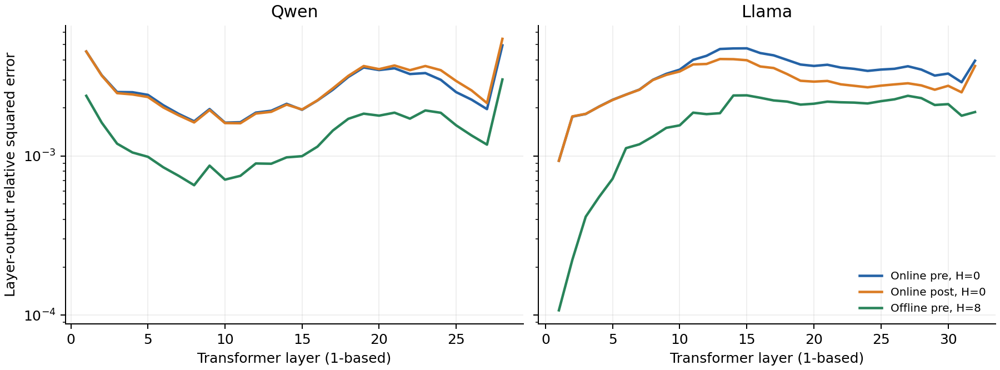
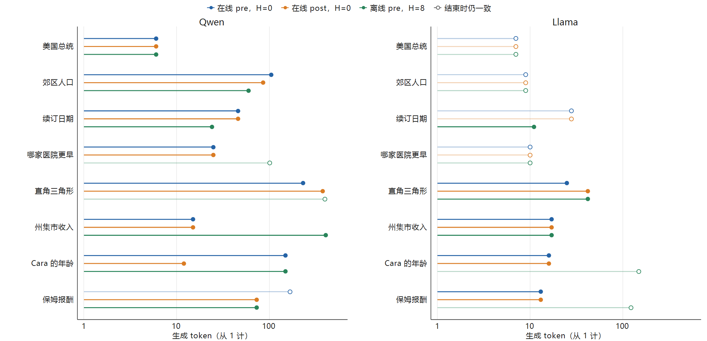

# 真实生成与误差来源

本文回答四种共同 K8V4 表示能否保持真实生成质量，以及近期残留如何改变类通过、量化误差如何沿层与生成步传到首次 token 分歧。更新日期为 2026-10-13。测量包括两模型四候选的冻结 V 质量、近期残留、三个开发候选的配对传播诊断，以及 32K 检索和完整四问联答长解码上的 BF16、KV8 与 K8V4 工作点比较。

**来源说明**

- 指导与配置：`research/phase1/guide.md`、`research/phase1/configs/data.md`、`research/phase1/configs/quality.md` 和 `research/phase1/configs/results.md` 规定输入、判定、字段与单位；`trajectory_replay.json`、`retrieval.json` 和 `long_decode.json` 位于同一配置目录，分别冻结传播、数字检索与四问联答条件。
- 执行代码：`research/phase1/experiments/generation_error_sources/code/`；`quantized_generation.py` 执行量化生成，`trajectory_replay.py` 执行传播回放，`four_question_baseline.py` 冻结并评估四问参考，`new_input_quality.py` 汇总新输入的配对质量。
- 正式结果与审核：结果根目录见文首 YAML。“主比较”来自每模型 `v_gsm8k_*.json`、`v_hotpot_*.json` 与 `no_residual_selection.json`；“残留比较”来自 `residual_diagnostics.json` 与对应逐题结果。“传播诊断”来自每模型 `trajectories.json`，复算审核见 `trajectory_review.json`。“新输入比较”来自 `new_input_quality.json`、每模型 `v_retrieval_ruler_*.json` 与 `v_hotpot_four_*.json`；BF16 基线和配对结果分别经 `retrieval_baseline_review.json`、`long_decode_baseline_review.json` 与 `new_input_quality_review.json` 审核。
- 详细记录：新输入与完整预测由 `new_input_sources.json` 索引；输入划分为 `research/phase1/splits/retrieval_ruler.json` 和 `research/phase1/splits/hotpot_four.json`。执行源码、详细测量和准入记录由 `research/phase1/source_index.json` 与 `research/phase1/configs/runtime.md` 追溯。

## 实验目的

模型为 Qwen2.5-7B-Instruct（下称 Qwen）与 Llama-3.1-8B-Instruct（下称 Llama）。主比较为 BF16、均匀 KV8、均匀 KV4 和共同的四种 K8V4：Key 离线 per-channel／在线 per-token × pre／post-RoPE，Value 均为在线 per-token。初始 V 的 GSM8K 与单问 HotpotQA 各 64 题，独立统计单位为题目；新数字检索为 64 题，四问联答为 16 个请求、64 个问题，先平均请求内四题再对请求等权平均，独立统计单位为请求。传播诊断在共同的 8 道题上比较三个开发候选，固定 BF16 token 轨迹测量逐层、逐步输出，并在首次分歧处重建同格式历史 KV。

两模型均使用 BF16 权重与激活、SDPA prefill 和共同 FP32 注意力 decode，按贪心生成至 EOS 或冻结上限。首个生成 token 来自共同 BF16 prefill；量化条件随后读取并更新各自缓存，质量路径保存反量化 FP32 KV。GSM8K 与数字检索使用 EM，问答使用 token-F1；下降定义为参考减候选，单位为 0–100 分。候选同时相对 BF16 与 KV8：任一下降区间下界大于 2 分则淘汰，类通过要求各参加判断单元未淘汰且两个下降点估计均不超过 2 分；区间跨越 2 时登记证据不足。二值任务对配对分歧计算精确二项区间并作 Bonferroni 合成；连续分数按题目或请求配对重采样，10,000 次、种子 20260923，设置来源为质量配置与正式结果。全零连续差分不报告退化区间。

## 实验结果与结论

### 四种 K8V4 与均匀基线的生成质量

主比较下表均为 H=0，每个完整单元为 64 题，GSM8K 列为答对题数，HotpotQA 列为题均 F1（0–100 分）。在线／离线分别表示 Key 的 per-token／per-channel，pre／post 表示 RoPE 顺序；均匀 KV8、KV4 使用在线 post，Value 均为在线 per-token。提前停止格只报告实际观察量。

| 模型 | 条件 | GSM8K 答对题数 | HotpotQA F1（分） |
| --- | --- | ---: | --- |
| Qwen | BF16 | 58/64 | 50.23 |
| Qwen | KV8，在线 post | 60/64 | 46.31 |
| Qwen | K8V4，离线 pre | 59/64 | 44.46 |
| Qwen | K8V4，离线 post | 57/64 | 26.74 |
| Qwen | K8V4，在线 pre | 59/64 | 49.32 |
| Qwen | K8V4，在线 post | 59/64 | 45.83 |
| Qwen | KV4，在线 post | 0/9（提前停止） | 未运行 |
| Llama | BF16 | 58/64 | 67.70 |
| Llama | KV8，在线 post | 58/64 | 67.62 |
| Llama | K8V4，离线 pre | 58/64 | 65.19 |
| Llama | K8V4，离线 post | 59/64 | 58.46 |
| Llama | K8V4，在线 pre | 57/64 | 67.70 |
| Llama | K8V4，在线 post | 58/64 | 67.70 |
| Llama | KV4，在线 post | 57/64 | 63.70 |

Qwen 的离线 post-RoPE 有明显的问答退化。在线 pre-RoPE 得到 49.32 F1，接近 BF16 的 50.23；在线 post-RoPE 与离线 pre-RoPE 分别为 45.83 和 44.46。GSM8K 四种表示的题数差小于问答差异，主矩阵与任务分数的条件排序不同。

Llama 两种在线表示的问答 F1 均为 67.70，离线 pre／post 分别为 65.19 和 58.46。下表核对四种 K8V4 的问答配对下降，括号为 95% 区间，单位为分。

| 模型 | K8V4 Key／RoPE | 对 BF16 下降 [95% 区间] | 对 KV8 下降 [95% 区间] | 状态 |
| --- | --- | ---: | ---: | --- |
| Qwen | 离线 pre | 5.77 [-3.21, 15.04] | 1.86 [-7.34, 11.29] | 证据不足 |
| Qwen | 离线 post | 23.49 [13.18, 34.03] | 19.58 [9.53, 29.83] | 淘汰 |
| Qwen | 在线 pre | 0.91 [-4.42, 6.44] | -3.01 [-9.68, 3.78] | 证据不足 |
| Qwen | 在线 post | 4.40 [-2.59, 11.49] | 0.48 [-5.79, 6.87] | 证据不足 |
| Llama | 离线 pre | 2.51 [-0.45, 6.52] | 2.43 [-0.45, 6.23] | 证据不足 |
| Llama | 离线 post | 9.24 [3.41, 15.82] | 9.17 [3.37, 15.67] | 淘汰 |
| Llama | 在线 pre | 0.00（全零差分） | -0.07 [-3.35, 3.12] | 证据不足 |
| Llama | 在线 post | 0.00（全零差分） | -0.07 [-3.35, 3.12] | 证据不足 |

两模型的离线 post-RoPE 问答区间下界都高于 2，按冻结规则淘汰。其余 K8V4 的问答状态均为证据不足。Qwen 均匀在线 KV4 在初始 GSM8K 前 9 题中出现严重失效，实际观察量为 9 题，记录中止状态。

H=0 下，Qwen 在线 pre-RoPE 的两个任务均类通过；Llama 两种在线表示的两个任务均类通过。近期残留的比较进一步考察这些表示的分数变化，以及离线 pre-RoPE 能否达到类通过门槛。

### 三种未淘汰表示的近期残留质量

固定近期残留窗口 R=128 token，H 表示副本位宽（bit），H=0 表示不保留副本。按格式比较两个模型三种未淘汰 K8V4 在 H=0、H=8 与 H=16 的质量。每个实测任务单元均为初始 V 的 64 题，GSM8K 为答对题数，HotpotQA 为题均 F1；缺失组合标为未测。全部实测条件的质量状态均为证据不足，表内“是／否”表示类通过。

**离线 pre-RoPE：Key 离线 per-channel。**

| 模型 | H | 测量状态 | GSM8K 答对题数（n=64） | HotpotQA F1（分） | 短生成／检索类通过 |
| --- | ---: | --- | ---: | ---: | --- |
| Qwen | 0 | 实测 | 59 | 44.46 | 是／否 |
| Qwen | 8 | 实测 | 58 | 45.68 | 否／否 |
| Qwen | 16 | 实测 | 60 | 44.82 | 是／否 |
| Llama | 0 | 实测 | 58 | 65.19 | 是／否 |
| Llama | 8 | 实测 | 60 | 66.00 | 是／是 |
| Llama | 16 | 实测 | 60 | 66.00 | 是／是 |

**在线 pre-RoPE：Key 在线 per-token。**

| 模型 | H | 测量状态 | GSM8K 答对题数（n=64） | HotpotQA F1（分） | 短生成／检索类通过 |
| --- | ---: | --- | ---: | ---: | --- |
| Qwen | 0 | 实测 | 59 | 49.32 | 是／是 |
| Qwen | 8 | 实测 | 58 | 42.84 | 否／否 |
| Qwen | 16 | 实测 | 59 | 44.12 | 是／否 |
| Llama | 0 | 实测 | 57 | 67.70 | 是／是 |
| Llama | 8 | 未测 | — | — | 未归类 |
| Llama | 16 | 实测 | 60 | 67.70 | 是／是 |

**在线 post-RoPE：Key 在线 per-token。**

| 模型 | H | 测量状态 | GSM8K 答对题数（n=64） | HotpotQA F1（分） | 短生成／检索类通过 |
| --- | ---: | --- | ---: | ---: | --- |
| Qwen | 0 | 实测 | 59 | 45.83 | 是／否 |
| Qwen | 8 | 未测 | — | — | 未归类 |
| Qwen | 16 | 实测 | 59 | 45.26 | 是／否 |
| Llama | 0 | 实测 | 58 | 67.70 | 是／是 |
| Llama | 8 | 实测 | 60 | 67.23 | 是／是 |
| Llama | 16 | 实测 | 60 | 66.58 | 是／是 |

Llama 离线 pre-RoPE 的 HotpotQA 在 H=0 时不类通过，H=8 与 H=16 均达到 66.00 F1，两个任务都类通过。Qwen 在线 pre-RoPE 在 H=0 时两个任务都类通过；H=16 问答为 44.12 F1，失去检索类通过；H=8 问答为 42.84 F1，短生成与检索都不类通过。在线 post-RoPE 的 H=0 上，Llama 两个任务都类通过，Qwen 短生成类通过、检索不类通过；H=16 保持同一类通过结果。Qwen 离线 pre-RoPE 的 H=8 已完成两个任务各 64 题，短生成与检索均不类通过。进入下一步的三项按优先级为在线 pre-RoPE、H=0，在线 post-RoPE、H=0，离线 pre-RoPE、H=8。

配对下降补充这一排序，单位为分，正值表示相对参考退化。每项 64 题，区间算法与主比较相同。H=0 的问答下降见主比较。在线 pre-RoPE、H=0 的 GSM8K 下降，Qwen 相对 BF16、KV8 分别为 -1.56 [-9.56, 6.60] 与 1.56 [-6.60, 9.56]，Llama 相对两项参考均为 1.56 [-6.60, 9.56]。在线 post-RoPE、H=0 的 GSM8K 下降，Qwen 相对 BF16、KV8 分别为 -1.56 [-9.56, 6.60] 与 1.56 [-6.60, 9.56]，Llama 相对两项参考均为 0.00 [-9.54, 9.54]。离线 pre-RoPE、H=8 的 Llama 测量中，GSM8K 相对两项参考均为 -3.13 [-12.10, 6.35]，问答相对 BF16 为 1.70 [0.00, 4.52]，相对 KV8 为 1.63 [0.00, 4.30]。Qwen 离线 pre-RoPE、H=8 的 GSM8K 相对 BF16、KV8 的下降分别为 0.00 [-9.54, 9.54] 与 3.13 [-6.35, 12.10]，HotpotQA 分别为 4.55 [-2.14, 11.29] 与 0.63 [-7.17, 8.45]。相对同格式 H=0，H=8 减 H=0 的配对变化为 GSM8K -1.56 [-9.56, 6.60]、HotpotQA 1.23 [-5.04, 8.00]，正值表示改善。

静态层分配按配置接收在线 pre-RoPE、H=0，在线 post-RoPE、H=0，以及离线 pre-RoPE、H=8、R=128 三种格式。每种格式以全层 K8V4 为参照，比较敏感度、重建、反向与三个随机策略的固定预算 Key 降位宽结果；完整配置再参加独立生成和成本比较。

### 共同 token 轨迹中的跨层、跨步传播

传播诊断比较在线 pre-RoPE、H=0，在线 post-RoPE、H=0，以及离线 pre-RoPE、H=8、R=128。GSM8K 与 HotpotQA 各取 4 题：在两模型、三个候选的历史评分中，按正向质量损失之和选择最大的 3 题，再取六组评分全部稳定的 1 题；题目在回放前冻结，两模型使用同一组。保持完整输入、贪心解码及 1,024-token 上限，每题先生成 BF16 参考，再让三个候选逐步接收相同 token、各自更新 KV。两模型分别回放 1,685 和 812 个参考 decode 步，共完成 48 条候选轨迹。

两模型均在 RTX 4090 上完成，权重与激活为 BF16，注意力为共同 FP32 路径。Llama 的前 8 层缓存以原 dtype 暂存 CPU，搬运与常驻路径通过逐值一致性核验。48 条自由生成的首次分歧均与共同 token 回放定位一致。

记 BF16 与候选在第 $\ell$ 层、第 $t$ 步的层末隐藏状态为 $h_{\ell,t}$、$\hat h_{\ell,t}$，对应词表分布为 $p_t$、$\hat p_t$。测量

$$
E_{\ell,t}=\frac{\|\hat h_{\ell,t}-h_{\ell,t}\|_2^2}{\|h_{\ell,t}\|_2^2},
\qquad D_t=D_{\mathrm{KL}}(p_t\|\hat p_t).
$$

下表来自传播诊断，每模型、每候选均为相同 8 题；先在每题的全部参考 decode 步内平均，再对题目等权平均。相对平方误差无量纲，KL 单位为 nat。

| 模型 | 候选 | 末层相对平方误差 | 词表 KL（nat） |
| --- | --- | ---: | ---: |
| Qwen | 在线 pre，H=0 | 0.004945 | 0.002573 |
| Qwen | 在线 post，H=0 | 0.005432 | 0.002412 |
| Qwen | 离线 pre，H=8 | 0.003019 | 0.004956 |
| Llama | 在线 pre，H=0 | 0.003960 | 0.001014 |
| Llama | 在线 post，H=0 | 0.003669 | 0.001100 |
| Llama | 离线 pre，H=8 | 0.001885 | 0.000780 |

离线 pre、H=8 在两模型上都有较小的末层隐藏状态误差，但 Qwen 的词表 KL 反而最高；Llama 上两项指标均最低。隐藏状态相对平方误差的排序并不直接给出词表分布变化的排序。

图中每层仍采用先步内、后题间的平均，层序从 1 开始，与横轴一致。Qwen 的层误差先下降，在第 8–11 层附近达到各候选的最低点，随后起伏并在第 28 层达到最大值；Llama 从首层上升，在第 13–15 层达到峰值，后段回落并在末层局部回升。跨层相对误差既有上升，也有下降。

### 同格式历史重建检验跨步数值反馈

每题、每候选至多在首次 argmax 分歧处进行一次干预：将此前已生成 token 的 KV 源值替换为 BF16 参考的源值，再按原候选的位宽、RoPE 顺序及近期窗口重新量化；当前输入 token 和 prompt 缓存保持一致。此时两条自由轨迹尚未出现不同的历史 token，干预改变的是已生成历史中的数值状态。

下表对同一条件内实际触发的干预位置配对平均 KL。“恢复”指该位置的候选 argmax 恢复为 BF16 argmax。

| 模型 | 候选 | 干预位置数 | 原轨迹 KL（nat） | 重建后 KL（nat） | 恢复位置数 |
| --- | --- | ---: | ---: | ---: | ---: |
| Qwen | 在线 pre，H=0 | 7 | 0.114414 | 0.106514 | 3 |
| Qwen | 在线 post，H=0 | 8 | 0.011239 | 0.006869 | 4 |
| Qwen | 离线 pre，H=8 | 6 | 0.568485 | 0.204750 | 2 |
| Llama | 在线 pre，H=0 | 4 | 0.012754 | 0.004139 | 1 |
| Llama | 在线 post，H=0 | 4 | 0.013690 | 0.003748 | 2 |
| Llama | 离线 pre，H=8 | 3 | 0.009640 | 0.004833 | 1 |

32 个干预位置中，13 处的分歧在移除历史源值偏移后消失，候选 argmax 恢复为 BF16，说明此前写回的历史 KV 源值偏移参与了这些位置的分歧。其余 19 处在同格式重建后仍然分歧，移除这部分偏移不足以消除它们。

三代年龄题中，祖母 75 岁、母亲比祖母小 15 岁、Cara 比母亲小 20 岁。Llama 在线 pre 在第 16 个生成 token 分歧，BF16 的第一、第二名 logit 间隔为 0.375；重建使 KL 从 0.030812 降至 $8.85\times10^{-7}$，并恢复 BF16 的下一 token。在线 post 在同处的 KL 从 0.030809 降至 0.001901，也恢复了下一 token。

同一干预里，历史源值偏移的作用方向并不相同。Qwen 的集市收入题中，在线 pre 在第 15 个 token 的 KL 由重建前 0.007731 增至重建后 0.024026，分歧仍存在；离线 pre、H=8 在第 406 个 token 的 KL 则从 0.488245 降至 0.281442，并恢复 BF16 的空格 token。移除历史源值偏移后，有的位置 KL 下降并恢复下一 token，有的位置 KL 上升且分歧仍在。

### 汇总误差与首次 token 分歧的位置

前述逐层曲线包含放大与回落，末层相对平方误差与全程平均 KL 的排序也不同。下面进一步核对这两个汇总量与首次 token 分歧的位置。

下图标出 48 条轨迹的首次 argmax 分歧，生成 token 从 1 计数。实心点是候选 argmax 第一次离开 BF16 的位置，点前的线段表示此前各步仍然相同；空心点表示参考轨迹结束时 argmax 仍与 BF16 相同。

32 条出现分歧，16 条没有。最早的分歧在第 6 个生成 token，最晚在第 406 个。州集市收入题上，Qwen 两个在线候选在第 15 个 token 分歧，离线 pre、H=8 在第 406 个 token 分歧，该步 KL 为 0.488245 nat；Llama 三个候选都在第 17 个 token 分歧。这 32 个分歧步里，有 6 个的 KL 不低于该轨迹此前和此后的峰值，其余轨迹在分歧之前或之后还有更大的 KL。跨层和跨步传播都包含放大与回落，误差沿深度、沿生成长度都不是单调累积。末层隐藏误差、全程平均 KL 和首次分歧步是三个不同的量，前两个的排序不能代替分歧出现的位置。

### 32K 数字检索的工作点比较

新输入比较复用已审核的两模型 BF16 参考，在相同输入上完成五种量化条件：均匀 KV8、两个在线 K8V4 的 H=0，以及离线 pre-RoPE K8V4 的 H=0 与 H=8、R=128。每模型、每条件运行 64 个检索请求和 16 个四问联答请求，共完成 800 次新生成，并与 160 次 BF16 生成配对。本文“在线 pre／post”表示 Key 在线 per-token，“离线 pre／post”表示 Key 离线 per-channel，pre／post 指 RoPE 量化顺序；Value 均为在线 per-token。

数字检索以随机七位键值和重复背景构造输入，目标深度为 10%、35%、65% 和 90%，干扰键值数为 1 和 8。两模型使用相同随机键值与分层分组，各自按 tokenizer 装箱；Qwen 输入为 31,722–31,732 token，Llama 为 31,738–31,744 token。评分抽取回答中的七位数字，只有唯一数字值与目标一致时计为正确。下表来自“新输入比较”，每模型、每条件均为完整 64 题，EM 单位为百分比。

| 条件 | Qwen 正确检索 | Llama 正确检索 | 两模型 EM（%） |
| --- | ---: | ---: | ---: |
| BF16 | 64/64 | 64/64 | 100.00 |
| KV8，在线 post，H=0 | 64/64 | 64/64 | 100.00 |
| K8V4，在线 pre，H=0 | 64/64 | 64/64 | 100.00 |
| K8V4，在线 post，H=0 | 64/64 | 64/64 | 100.00 |
| K8V4，离线 pre，H=0 | 64/64 | 64/64 | 100.00 |
| K8V4，离线 pre，H=8、R=128 | 64/64 | 64/64 | 100.00 |

BF16 与五种量化条件在两模型上均为 64/64，八个深度与干扰组合均为 8/8，全部请求由 EOS 结束。BF16 达到 90% 的基线能力下限，三个 K8V4 工作点及离线 H=0 对照保持相同的满分检索表现。量化条件相对 BF16 与 KV8 的下降均为 0.00 分，配对分歧的保守 95% 区间均为 [-6.62, 6.62] 分；新数字检索单元全部类通过，状态表均为证据不足。

### 四问联答的生成质量与配对下降

四问联答按“全部四份证据 A、题内干扰文档、间隔填料、全部四份证据 B、末尾填料”的顺序装箱，四个问题与输出要求放在材料之后。每个证据对相隔至少 8,192 token；输入与 1,024-token 输出预算合计不超过 32,768。输出要求为每题 3–5 句证据说明，最后给出四行编号短答案。评分取每个编号的末次标签，接受同行或下一非空行的答案，缺失答案计零。每模型、每条件为 16 次请求、64 个问题；F1 为请求内四题先平均、再对请求等权平均，单位为 0–100 分。下表为复用的 BF16 参考，长度是每次请求实际生成的 token 数。

| 模型 | 请求均 F1（分） | 输出 token 范围 | 平均输出 token | 达到 256 token | EOS 请求数 | 上限截断请求数 | 缺失短答案数 |
| --- | ---: | ---: | ---: | ---: | ---: | ---: | ---: |
| Qwen | 64.30 | 278–949 | 528.25 | 16/16 | 16/16 | 0 | 0 |
| Llama | 72.54 | 436–1,024 | 635.56 | 16/16 | 14/16 | 2 | 6 |

两模型的全部 BF16 请求都达到 256 token，请求均 F1 均高于 40 分的基线能力下限，长解码配对使用各自完整的 16 次请求。Llama BF16 的两个请求在 1,024 token 处截断，分别缺失两个和四个短答案；这些缺失答案按零分计入 72.54 F1。

下表来自“新输入比较”，展示五种量化条件的请求均 F1 与缺失答案。全部量化请求均达到 256 token；Qwen 每个条件均为 16 次 EOS，Llama 每个条件均为 15 次 EOS 和 1 次上限截断。提前结束、截断及缺失答案均按原评分保留在请求配对中。

| 条件 | Qwen F1（分） | Llama F1（分） | Qwen 缺失短答案数 | Llama 缺失短答案数 |
| --- | ---: | ---: | ---: | ---: |
| KV8，在线 post，H=0 | 68.41 | 77.05 | 0 | 2 |
| K8V4，在线 pre，H=0 | 70.47 | 76.79 | 0 | 2 |
| K8V4，在线 post，H=0 | 68.62 | 75.00 | 0 | 2 |
| K8V4，离线 pre，H=0 | 43.41 | 74.76 | 16 | 6 |
| K8V4，离线 pre，H=8、R=128 | 62.51 | 79.33 | 4 | 2 |

三个研究候选中，Qwen 两个在线 H=0 工作点的 F1 分别为 70.47 和 68.62，均高于 BF16 的观测均值；离线 H=8、R=128 为 62.51，相对 BF16 下降 1.79 分。Llama 三个工作点分别为 76.79、75.00 和 79.33，均高于 BF16 的观测均值。结合满分检索，三个工作点在这组长上下文输入与四问长解码中保持了接近或高于 BF16 的观测水平，继续作为后续研究候选；按优先级为 K8V4，在线 pre、H=0，K8V4，在线 post、H=0，以及 K8V4，离线 pre、H=8、R=128。

类通过同时核对 BF16 与 KV8。下表为 K8V4 的配对下降，正值表示退化，单位为分；95% 区间以请求为独立单位，使用 10,000 次配对重采样和种子 20260923。“类通过”按两个下降点估计及淘汰状态判断，“状态”按区间登记。

| 模型 | K8V4 条件 | 对 BF16 下降 [95% 区间] | 对 KV8 下降 [95% 区间] | 长解码类通过 | 状态 |
| --- | --- | ---: | ---: | --- | --- |
| Qwen | K8V4，在线 pre，H=0 | -6.18 [-17.11, 3.99] | -2.06 [-10.26, 5.21] | 是 | 证据不足 |
| Qwen | K8V4，在线 post，H=0 | -4.33 [-14.78, 6.28] | -0.21 [-7.08, 6.45] | 是 | 证据不足 |
| Qwen | K8V4，离线 pre，H=0 | 20.89 [6.21, 36.33] | 25.00 [10.80, 40.35] | 否 | 淘汰 |
| Qwen | K8V4，离线 pre，H=8、R=128 | 1.79 [-12.98, 18.88] | 5.90 [-6.90, 21.34] | 否 | 证据不足 |
| Llama | K8V4，在线 pre，H=0 | -4.25 [-13.43, 3.92] | 0.26 [-6.51, 7.03] | 是 | 证据不足 |
| Llama | K8V4，在线 post，H=0 | -2.46 [-14.81, 6.70] | 2.05 [-3.39, 7.34] | 否 | 证据不足 |
| Llama | K8V4，离线 pre，H=0 | -2.21 [-17.83, 15.63] | 2.29 [-7.81, 17.50] | 否 | 证据不足 |
| Llama | K8V4，离线 pre，H=8、R=128 | -6.78 [-18.99, 2.78] | -2.27 [-7.18, 2.82] | 是 | 证据不足 |

在线 pre、H=0 在两模型上均长解码类通过。在线 post、H=0 在 Qwen 上类通过，Llama 相对 KV8 下降 2.051 分，比 2 分门槛高 0.051 分，状态为证据不足。离线 pre、H=8、R=128 在 Llama 上类通过；Qwen 相对 BF16 下降 1.787 分，相对 KV8 下降 5.900 分，未类通过，状态同样为证据不足。三个开发候选的区间状态均为证据不足。

### 离线 pre-RoPE 的近期残留作用

新输入比较在相同的 16 个四问请求上配对 H=0 与 H=8，R=128 token；增益为 H=8 减 H=0，请求为独立统计单位，区间方法与四问质量比较相同。离线 pre 的配对显示出两模型不同的缓冲效果。Qwen 的 H=0 为 43.41 F1，相对 BF16 与 KV8 的下降区间下界分别为 6.21 和 10.80 分，按规则淘汰；H=8 将 F1 提高 19.10 分，配对 95% 区间为 [5.73, 33.21] 分，缺失短答案从 16 个降至 4 个。H=8 后两个参考的下降区间均跨越 2，且相对 KV8 的点估计仍超过门槛，因此登记为两个已测精度都未类通过。Llama 的 H=0 为 74.76 F1，H=8 为 79.33；配对增益为 4.57 分，区间为 [-6.17, 20.01] 分。其 H=0 未类通过、H=8 类通过，按判定规则登记为依赖缓冲，增益区间包含零。

## 总结

两模型的离线 post-RoPE 在单问 HotpotQA 上淘汰，其余表示进入近期残留比较。Qwen 在线 pre-RoPE 在 H=0 时两个初始任务均类通过；Llama 离线 pre-RoPE 在 H=8 时挽回问答类通过。配对传播诊断显示跨层与跨步误差均有放大和回落，末层隐藏误差与全程平均 KL 的排序不能代替首次分歧位置；同格式历史重建恢复了 13/32 处的 BF16 argmax。新输入比较完成 800 次量化生成，并与 160 次 BF16 生成配对：全部条件在两模型上均正确检索 64/64 个目标，三个开发候选的四问平均 F1 接近或高于 BF16，区间状态均为证据不足。在线 pre、H=0 在两模型上长解码类通过；Llama 在线 post、H=0 与 Qwen 离线 pre、H=8 相对 KV8 的下降分别为 2.051 和 5.900 分，未类通过。Qwen 离线 H=8 相对 H=0 的四问配对增益为 19.10 分，Llama 离线条件登记为依赖缓冲。

下一项静态层分配接收在线 pre-RoPE、H=0，在线 post-RoPE、H=0，以及离线 pre-RoPE、H=8、R=128 三种格式，Value 固定 INT4。同格式全层 K8V4 和 KV4 为端点，敏感度、重建、反向与三个随机策略按相同 K4 层数比较，保护随机检验高敏感层的作用；随后用冻结层表与 BF16、KV8 对照，核对独立生成质量和完整成本。
