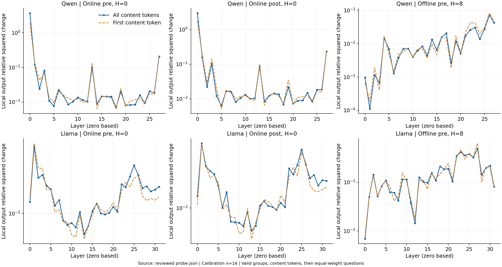
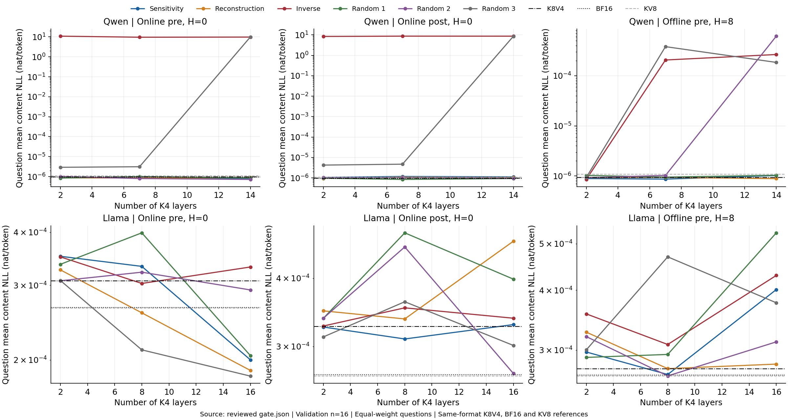

# Key 层间代价与静态混合位宽的独立生成验证

本文检验局部 Key 敏感度能否识别降位宽代价，以及冻结配置能否在独立生成任务上保持质量并减少完整 KV 成本。测量对象为两模型的逐层注意力输出、正确答案路径损失、独立生成分数与完整 KV 布局。更新日期为 2026-10-13。

**来源说明**

- 指导与配置：`research/phase1/guide.md`、`research/phase1/configs/static_layer_allocation.json`、`research/phase1/configs/static_numerics.json` 和 `research/phase1/configs/quality.md` 规定层分配、数值诊断与独立生成判定。
- 执行代码：`research/phase1/experiments/static_layer_allocation/code/`；`content.py` 执行内容路径测量，`numerics.py` 执行配对精度诊断，`quality.py` 执行冻结候选的独立生成。
- 正式结果与审核：结果根目录见文首 YAML。“层间代价”与“固定预算比较”来自每模型 `probe.json`、`numerics_summary.json`、`numerical_allocations.json` 和 `rescoring.json`，审核见 `review.json` 与 `numerics_review.json`。“独立生成”来自 `final_quality/`、`reference_expansion/` 与 `expanded_quality/`，最终审核见 `final_quality_review.json`；首轮参考使用 `research/phase1/experiments/generation_error_sources/results/`，复用核对见 `reference_reuse.json`。
- 详细记录：完整路径、逐题数值包络、层名单及执行来源由正式结果和 `research/phase1/source_index.json` 索引；对应成本来自 `research/phase1/experiments/storage_service_cost/results/`。校准数值诊断使用 RTX 4090；独立生成及复用参考使用 RTX 6000 Ada、BF16 权重与激活和 FP32 注意力。

## 实验目的

两模型为 Qwen2.5-7B-Instruct（下称 Qwen，28 层）和 Llama-3.1-8B-Instruct（下称 Llama，32 层），Value 固定 INT4。校准实验分别使用在线 per-token pre/post-RoPE（H=0）和离线 per-channel pre-RoPE（H=8、R=128），每模型校准与验证各 16 道检索题，验证题不参与位宽表生成，离线参数只使用校准折的检索题与数学题。三档 K4 层数为 Qwen 2/7/14、Llama 2/8/16；敏感度、重建、反向、三个随机及三个保护随机均满足相同预算。局部敏感度识别层间代价，完整配置通过损失、生成与成本检验。

独立验证冻结 Qwen 在线 post 的半层 K4、Llama 在线 pre 的半层 K4 和全层 KV4，全部 H=0；Llama 优先检验全层 KV4。GSM8K、32K 数字检索和单问 HotpotQA 按 64→128→256 题扩样，四问联答按 16→32→64 个请求扩样。使用既定贪心生成，检索上限 128 token，其余任务 1,024 token；BF16 准入下限分别为数学 50、检索 90、问答 40 分。首轮参考复用，只追加必要 BF16、KV8 缺样。分数下降定义为参考减候选：相对 BF16、KV8 的配对 95% 区间上界均不超过 2 分方可保留；任一下界超过 2 分则淘汰，其余记证据不足，并按冻结规则扩样或停止。

## 实验结果与结论

### 不同表示下 Key 降位宽的层间代价

局部 $S$ 测量共同高精度轨迹、同一 V4 下 K4V4 与 K8V4 注意力输出的相对平方变化，以共同 BF16 输出能量为分母；两份 K 从同一源直接量化，先平均有效 query 组，再平均内容位置和题目。下图为每模型 16 道校准题的逐层均值，层号从 0 开始，单位为相对平方变化；实线为全部内容位置，虚线为首内容位置。

Qwen 在线 pre/post 的最高敏感层均为第 0 层，最大与最小 $S$ 相差约 532、480 倍；离线 pre、H=8 的高敏感层转向 26、27、23、25 等后部层。敏感度与重建排名相关为 0.157–0.492，首内容与全部内容排名相关均超过 0.93。pre 重建统一沿用读时旋转后、近期副本替换前的主存张量口径。

单层验证以同格式全层 K8V4 为基线，仅一层改成 K4。下表为 Qwen 在线 post 的 16 道验证题，单位 nat/内容 token；内容 NLL 先题内平均再题间等权平均，点估计为当前实现的配对均值。区间以题目为独立统计单位，取每题在当前实现、FP32 输出头、FP32 输出头加 decode 残差三档精度及重复条件下的配对差值最小／最大值，再按题重采样形成均值的 95% 包络；使用 10,000 次重采样、种子 20261010017，设置来源为数值诊断配置。

| 降为 K4 的层 | 内容 ΔNLL（nat/token） | 95% 包络 | 内容正确数 |
| ---: | ---: | ---: | ---: |
| 0 | 8.1422 | [6.7991, 9.7717] | 0/16 |
| 27 | 3.46e−6 | [2.84e−7, 7.87e−6] | 15/16 |

基线为 15/16。第 0 层对应严重退化；第 27 层的增量可分辨，生成正确数保持不变。局部扰动、内容损失与生成错误承担不同证据角色。Llama 在线 post 在三种计算精度下均为 0/32 个可靠单层 ΔNLL，两半题目的排名相关为 0.135、−0.038、0.059；提高输出头及残差计算精度仍未建立稳定的端到端层排序。

### 固定预算 Key 分配的内容损失

各格式独立按校准排名选择 K4 层；保护随机固定最高两层为 K8，其余层沿冻结随机排列选择。下图为两模型、三格式、三预算的完整矩阵，每格验证 $n=16$，当前实现，单位 nat/内容 token；虚线为同格式 K8V4。

18 个工作点中，敏感度可靠低于全部三个随机策略为 0/18；其中 6 个在线 post 工作点包含完整精度包络，其余采用题目重采样。Qwen 在线包含第 0 层的反向及半层随机 3 出现严重失败，而保护 0、27 两层后，半层随机 3 从 0/16 恢复为 16/16，post 内容 NLL 从 8.4963 降至 $9.12\times10^{-7}$。在线 post 敏感度在三档预算都可靠低于随机 3，小预算差值包络为 $[-7.53\times10^{-6},-3.08\times10^{-7}]$。敏感度未可靠优于全部保护随机方案，精细排序的额外任务收益尚未建立。离线保护 26、27 后仍有 $10^{-4}$ 与 $10^{-6}$ 量级的损失差异，但对应正确数同为 15/16。

统一评分后，Llama 校准验证中的完整及单层配置均为内容正确 16/16、完整形式合规 10/16，六条差异来自省略 val-。在 Qwen 按键检索八位十六进制值的一个案例中，正确答案为 `val-8b6b444a`，BF16 却生成 `val-d694ade7`；强制输入正确分隔符后内容 NLL 仅为 $5.70\times10^{-9}$。因此完整路径和自由生成仍需独立评分；该轮 BF16 为 15/16，历史另一设备为 16/16。

校准验证的端点中，Qwen 在线全层 KV4 为 0/16，离线 pre、H=8 为 15/16；Llama 三格式全层 KV4 均为 16/16。独立 key/value 映射协议和替换映射控制的完整记录随正式结果保留。

### 冻结候选的独立生成质量与最终状态

以下四表为独立生成的最终档位。Qwen 混合指 post、14 层 K4；Llama 混合与 KV4 均为 pre、分别 16 层与全层 K4。EM 得分为百分比，F1 得分与下降均按 0–100 分记录，括号内为配对 95% 区间。GSM8K 和检索使用二值配对的 Bonferroni–Clopper–Pearson 区间；HotpotQA 使用题目／请求配对 bootstrap，10,000 次、种子 20260923。四问先对请求内四题 F1 平均，再对请求等权平均，并使用 BF16 输出至少 256 token 的共同子集；候选早停、缺答和触及上限均保留评分。

**GSM8K：EM（%），统计单位为题。**

| 配置 | n | BF16 | KV8 | 候选 | 相对 BF16 下降 [95% 区间] | 相对 KV8 下降 [95% 区间] | 状态 |
| --- | ---: | ---: | ---: | ---: | ---: | ---: | --- |
| Qwen 混合 | 256 | 92.58 | 93.75 | 92.97 | -0.39 [-4.93, 4.17] | 0.78 [-2.28, 3.75] | 证据不足 |
| Llama KV4 | 256 | 90.63 | 89.45 | 89.06 | 1.56 [-3.78, 6.82] | 0.39 [-4.81, 5.57] | 证据不足 |
| Llama 混合 | 64 | 90.63 | 90.63 | 90.63 | 0.00 [-11.84, 11.84] | 0.00 [-11.84, 11.84] | 证据不足 |

**32K 数字检索：EM（%），统计单位为题。**

| 配置 | n | BF16 | KV8 | 候选 | 相对 BF16 下降 [95% 区间] | 相对 KV8 下降 [95% 区间] | 状态 |
| --- | ---: | ---: | ---: | ---: | ---: | ---: | --- |
| Qwen 混合 | 256 | 100.00 | 100.00 | 99.61 | 0.39 [-1.69, 2.47] | 0.39 [-1.69, 2.47] | 证据不足 |
| Llama KV4 | 256 | 100.00 | 100.00 | 100.00 | 0.00 [-1.70, 1.70] | 0.00 [-1.70, 1.70] | 保留 |
| Llama 混合 | 64 | 100.00 | 100.00 | 100.00 | 0.00 [-6.62, 6.62] | 0.00 [-6.62, 6.62] | 证据不足 |

**单问 HotpotQA：F1（分），统计单位为题。**

| 配置 | n | BF16 | KV8 | 候选 | 相对 BF16 下降 [95% 区间] | 相对 KV8 下降 [95% 区间] | 状态 |
| --- | ---: | ---: | ---: | ---: | ---: | ---: | --- |
| Qwen 混合 | 256 | 42.20 | 41.58 | 41.98 | 0.22 [-3.90, 4.37] | -0.40 [-4.55, 3.89] | 证据不足 |
| Llama KV4 | 256 | 59.93 | 59.58 | 58.56 | 1.37 [-0.32, 3.21] | 1.02 [-0.80, 2.97] | 证据不足 |
| Llama 混合 | 64 | 67.70 | 67.62 | 66.92 | 0.78 [-2.85, 5.16] | 0.70 [-4.18, 5.97] | 证据不足 |

同一行样本上的辅助 EM（BF16／KV8／候选）分别为：Qwen 混合 27.34／26.56／26.17，Llama KV4 46.88／46.48／44.92，Llama 混合 54.69／54.69／51.56。

**四问联答：F1（分），统计单位为请求。**

| 配置 | n | BF16 | KV8 | 候选 | 相对 BF16 下降 [95% 区间] | 相对 KV8 下降 [95% 区间] | 状态 |
| --- | ---: | ---: | ---: | ---: | ---: | ---: | --- |
| Qwen 混合 | 64 | 57.86 | 60.12 | 56.33 | 1.52 [-4.41, 7.57] | 3.79 [-1.29, 9.04] | 证据不足 |
| Llama KV4 | 64 | 63.77 | 67.76 | 64.16 | -0.39 [-8.47, 7.75] | 3.60 [-3.45, 10.77] | 证据不足 |
| Llama 混合 | 16 | 72.54 | 77.05 | 64.55 | 8.00 [-8.11, 23.76] | 12.50 [3.20, 24.78] | 淘汰 |

Qwen 混合在四项任务均达到预定样本上限后仍证据不足；数字检索有 1/256 题相对两个参考退化，其下降区间上界为 2.47 分。Llama KV4 的检索 256 题与两个参考均无分歧，区间上界为 1.70 分，达到保留条件；其余三项仍证据不足。Llama 混合在首轮四问联答中，相对 KV8 下降 12.50 分，区间下界为 3.20 分，故停止该候选的进一步扩样。

四问各行的全部请求均满足 BF16 长度准入。Qwen 混合有 1 个不足 256-token 的输出，仍计入评分；Llama KV4 有 10 个请求触及上限、共缺 31 个答案，混合有 2 个请求触及上限、共缺 6 个答案。全部候选均无无效量化组。单问问答的 EM、检索分层得分、逐题差异和停止记录随正式结果保留。

### 同格式 K8V4 的首轮配对比较

同格式 K8V4 使用已有首轮共同样本：三个单题任务各 64 题、四问 16 个请求。下表为四问的同格式配对，单位为 F1 分，区间方法与上表相同。

| 配置 | n | 同格式 K8V4 | 候选 | K8V4 减候选 [95% 区间] |
| --- | ---: | ---: | ---: | ---: |
| Qwen 混合 | 16 | 68.62 | 55.33 | 13.29 [2.83, 23.67] |
| Llama KV4 | 16 | 76.79 | 67.85 | 8.94 [-7.52, 29.43] |
| Llama 混合 | 16 | 76.79 | 64.55 | 12.24 [2.68, 22.36] |

首轮 Qwen 与 Llama 混合相对同格式 K8V4 均出现明确的四问 F1 下降。Llama KV4 在首轮单问 64 题的同格式下降为 3.13 分，区间 [0.79, 6.32]。这些配对保留各自的共同样本范围，其余首轮比较由来源索引追溯。

### 冻结配置的完整存储成本

下表来自布局账本：32K、批量 1、物理块 64，包含载荷、量化参数、对齐、残留及标签，单位 MiB；本轮在线 H=0 的残留和标签均为零。

| 模型 | 既定 KV8 | 同格式 K8V4 | 半层 K4 | 同格式全层 KV4 |
| --- | ---: | ---: | ---: | ---: |
| Qwen，候选 post | 1008 | 784 | 672 | 560 |
| Llama，候选 pre | 2304 | 1792 | 1536 | 1280 |

两套混合布局相对同格式 K8V4 节省 14.3%，仍比全层 KV4 多占 20%；Llama KV4 相对 K8V4 节省 28.6%。完整成本的 73 个工作点及读写、转换和 pre-RoPE 旋转计数见[成本报告](../../storage_service_cost/report/index.md)。这些是布局与传输模型的收益，服务时间仍需计算吞吐与带宽实测。

## 总结

局部敏感度识别了 Qwen 在线的严重退化层，两层保护恢复了失败配置；精细排序的额外任务收益尚未建立，Llama 校准检索的单层效应仍缺少稳定信号。独立生成完成三套冻结候选与必要扩样：Qwen 混合和 Llama KV4 均按上限证据不足收尾，Llama 混合因四问联答淘汰；Llama KV4 的数字检索单元保留。完整层表、逐题结果、配对区间、失败条件与成本账本均已留存，重复参考及不必要扩样已清理。

下一项存储与服务成本实验接收上述冻结层表与分任务质量状态，固定比较 KV8、同格式 K8V4、半层混合和 KV4，核算完整驻留、连续 decode 读写、prefill 转换与 pre-RoPE 旋转。Qwen 混合与 Llama KV4 按样本上限证据不足收尾，Llama 混合保留四问淘汰结果，Llama KV4 交付数字检索的保留状态；成本与服务分析据此检验字节收益及所需实现条件。
