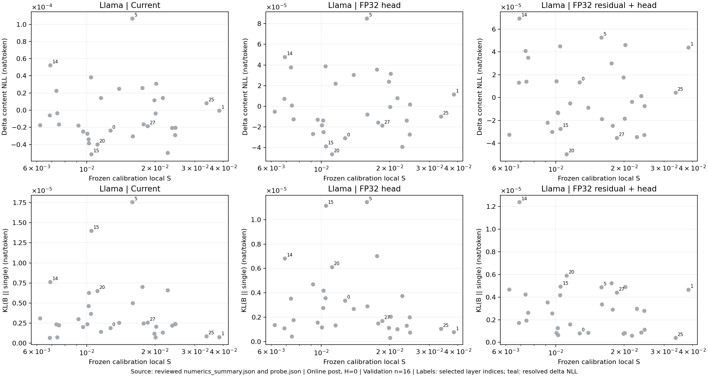
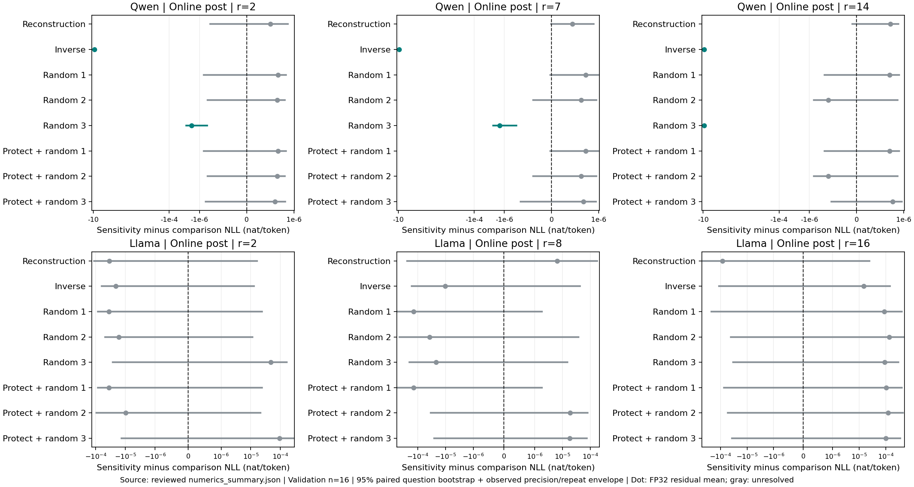
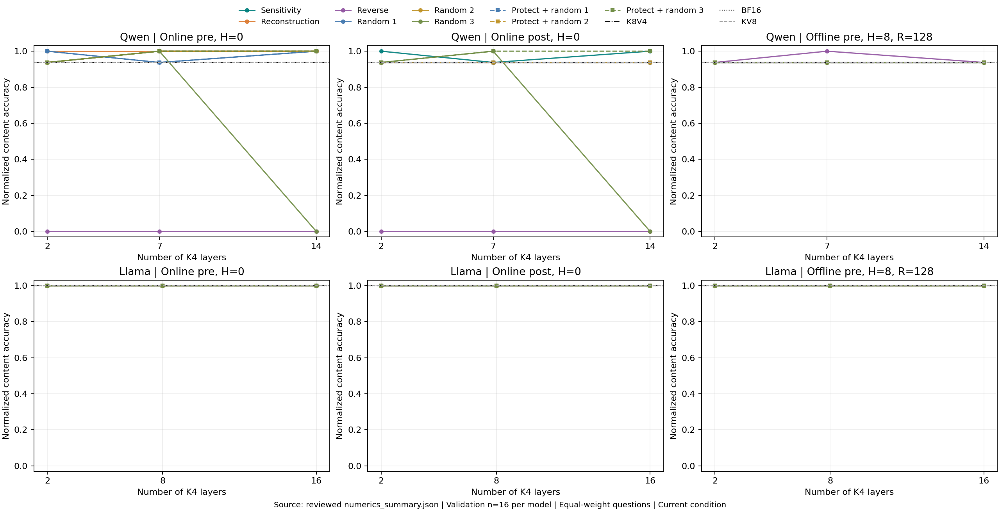
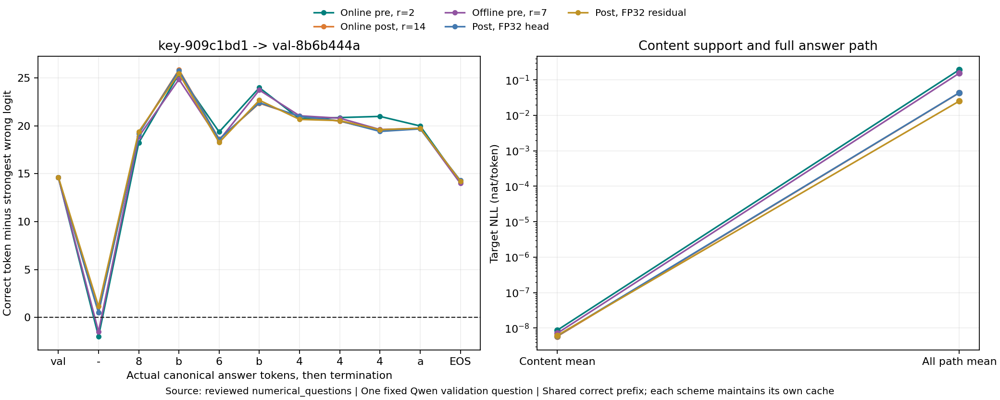
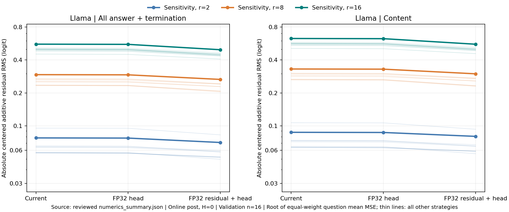
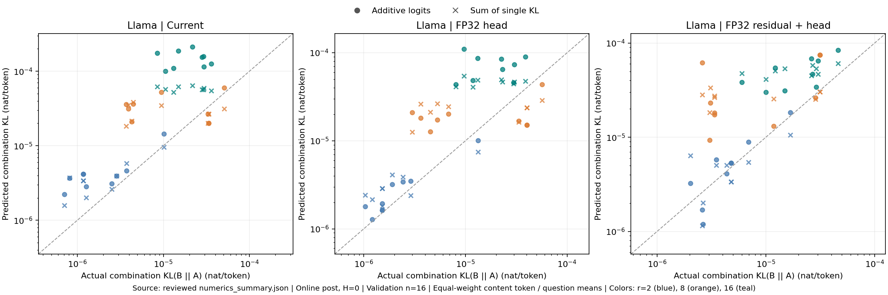

# Key 降位宽敏感度与静态层分配

本文回答：固定 Value 主存为 INT4 时，局部 Key 降位宽敏感度能否识别应保护的层，并形成较好的固定预算分配？更新日期为 2026-10-10。对象为 Qwen2.5-7B-Instruct 与 Llama-3.1-8B-Instruct，证据依次来自独立映射检索的局部输出变化、单层端到端影响、完整分配、答案路径及配对数值诊断。

来源说明：指导与冻结参数见 [阶段指导](../../../guide.md)、[静态分配配置](../../../configs/static_layer_allocation.json)、[配对数值配置](../../../configs/static_numerics.json)、[量化配置](../../../configs/quant.md)及[运行准入](../../../configs/runtime.md)；实际检索输入由 [冻结清单](../../../splits/static_retrieval.json)追溯。执行代码位于 [本实验代码目录](../code/)：内容探针与校准由 content.py、content_data.py、content_metrics.py 完成，allocations.py 计数完整成本；numerics.py、numerics_forward.py、numerics_metrics.py、numerics_summary.py、numerics_logits.py 完成完整路径、实际精度干预及原始 logits 诊断；numerics_review.py 审核，numerics_report_data.py 整理表格，numerics_plot.py 作图。下文“校准探针”“冻结分配”“历史重评”分别对应 [正式结果目录](../results/)两模型的 probe.json、allocations.json 与 numerical_allocations.json、rescoring.json；“完整矩阵”“配对诊断”对应 numerics_summary.json 和 numerical_questions/。原始校准及映射结果保留在 calibration.json、mapping.json、gate.json，原始输出审核见 numerics_review.json，实际执行见 numerics_execution.json。完整输入、预测、prefill 源值、词表 logits、执行版本与校验值集中在 [阶段来源索引](../../../source_index.json)。

校准探针和历史映射检查来自 RTX 6000 Ada 的既有测量；本轮完整矩阵与三精度诊断在 RTX 4090 上重新捕获每题 BF16 prefill，再固定这份源值用于该题所有精度与重复。Qwen 历史 BF16 内容正确为 16/16，本轮为 15/16；本轮各方案均与本轮共同参考配对。Llama 历史与本轮预测一致。每套方案读取相同正确 token 序列，独立维护持续更新的量化缓存；指标在 FP64 中计算，完整 logits 保存为 FP32。审核核对冻结输入、实际量化来源、位宽表、评分、逐题汇总及服务器原始 logits，随后生成本报告图表。

## 实验目的

第一项实验在在线 pre-RoPE、在线 post-RoPE 和离线 pre-RoPE 三种格式中，固定同一高精度轨迹的 query、层输入与 V4，测量各层 K 从 INT8 降为 INT4 的注意力输出变化，并由校准侧形成敏感度及重建排名。第二项实验将排名转成完整配置，比较少量、四分之一和一半 K 层降位宽的预算。原六种策略为敏感度、重建、反向及三个固定随机；增加三个“保护校准最高两层、其余随机”的同预算对照。主指标为正确答案内容 NLL，敏感度策略须可靠地严格低于全部三个随机策略，再分别比较重建、反向与保护随机。局部敏感度描述扰动幅度，单层测量检验边际代价，全层 KL 描述分布偏移，自由生成内容正确率检验实际回答。

Qwen 为 28 层，K4 层数 $r=2,7,14$；Llama 为 32 层，$r=2,8,16$。每模型冻结 C 的 32 道新检索题分为校准与验证各 16 题，覆盖 2K/4K、四个目标深度及低/高干扰，题目是独立统计单位。离线 K4/K8 参数分别用校准折的 32 道数学题与 16 道新检索题拟合。在线两格式为 per-token、H=0，离线 pre 为 per-channel、H=8、R=128；V 主存固定为在线 per-token INT4。三格式分别排名和构造分配，近期副本按同一规则保留并计入成本。数值诊断聚焦在线 post、H=0：Llama 测量全部 32 个单层，Qwen 测量两个校准保护层；两模型的基线、单层及全部预算组合均在三种计算精度下配对重测。

## 实验结果与结论

### 不同表示下 Key 降位宽的层间代价

旧 C 中两个模型各 32 条检索记录的 key 与正确 value 后缀全部相同，干扰 value 也带共同后缀。新清单将 key、正确 value 及各干扰 value 独立随机生成，题内后缀互异，保留长度、深度和干扰设置。八组配对保持 query key、填料和输入 token 总数，只替换上下文目标 value。以下使用统一重评：去首尾空白，完整小写八位十六进制值或带 val- 的完整值均可参加内容精确匹配；解释、多答案与子串命中均不接受。完整形式合规和原严格答案正确另行保存。

映射检查来自历史重评，每模型 $n=8$ 对，单位为题/对；旧题删除目标行的共同后缀统计保留为数据捷径控制。

| 模型 | 新原映射内容正确 | 新替换映射内容正确 | 两份均随映射正确 | 删旧目标后完整答案命中 | 删旧目标后仍含共同后缀 |
| --- | ---: | ---: | ---: | ---: | ---: |
| Qwen | 7/8 | 8/8 | 7/8 | 0/8 | 7/8 |
| Llama | 8/8 | 8/8 | 8/8 | 0/8 | 4/8 |

Llama 的八对内容全部随映射改变，原来的 3/8、4/8 严格结果来自部分输出省略前缀。旧题删除目标后，两模型都没有给出完整旧答案，却仍常输出共同后缀。例如查询 key-60be5790、旧答案 val-60be5790，Qwen 在目标行删除后给出 val-60be5790-d0。新映射的配对响应与该控制共同支持修复数据构造后开展降位宽测量。

令 $T_i$ 为实际分词中与 val- 后正确内容字符跨度相交的位置，跨边界 token 整体计入。预测 $y_t$ 时使用 $y_{<t}$，先测量再喂入当前目标。共同高精度注意力输出为 $o^{\mathrm{ref}}$，局部敏感度定义为

$$
S_\ell=\operatorname{平均}_i\operatorname{平均}_{t\in T_i}
\operatorname{平均}_{g\,\mathrm{有效}}
\frac{\|o^{K4V4}_{i,t,\ell,g}-o^{K8V4}_{i,t,\ell,g}\|_2^2}
{\|o^{\mathrm{ref}}_{i,t,\ell,g}\|_2^2}.
$$

$g$ 为 KV head 对应的 query head 组。K8、K4 从共同高精度源直接量化，离线使用各自冻结参数；V4、RoPE 和近期副本固定。先对有效组归一化，再平均内容位置，最后题目等权平均。零能量组按既定规则计数；本轮未触发无效量化或非有限输出停止。

图 1：来源为校准探针，每模型 $n=16$，单位为共同高精度输出能量归一化的相对平方变化；实线为全部内容位置，虚线为首内容位置，层号从 0 开始。表中相关为首内容与全部内容的逐层 Spearman 相关。

| 模型与格式 | 最高四层（从高到低） | 最小 S | 最大 S | 首内容/全部内容相关 |
| --- | --- | ---: | ---: | ---: |
| Qwen，在线 pre | 0, 27, 1, 13 | 0.0069806 | 3.717 | 0.932 |
| Qwen，在线 post | 0, 27, 1, 3 | 0.0062292 | 2.9887 | 0.950 |
| Qwen，离线 pre，H=8 | 26, 27, 23, 25 | 0.00011119 | 0.071478 | 0.967 |
| Llama，在线 pre | 1, 25, 3, 26 | 0.0059047 | 0.05495 | 0.945 |
| Llama，在线 post | 1, 25, 26, 24 | 0.0062313 | 0.038506 | 0.965 |
| Llama，离线 pre，H=8 | 27, 23, 25, 24 | 0.00068727 | 0.049072 | 0.955 |

Qwen 在线两格式的第 0 层最敏感，最大与最小相差约 532、480 倍；离线高敏感区移到后部，幅度差约 643 倍。Llama 在线高敏感层为第 1 层及后部 24–26 层，幅度差约 9.3、6.2 倍，离线差距约 71 倍。首内容与全部内容的排序相关均超过 0.93，扩大到全部内容没有大幅改变局部排序；三个格式仍产生各自的排序。

同时核验 $E_8=\|o^{K8V4}-o^{\mathrm{ref}}\|^2/\|o^{\mathrm{ref}}\|^2$ 与 $E_4$。重建对照使用 K4 相对高精度 K 的逐 KV head 相对平方重建误差；pre 格式沿用读时旋转后主存、近期副本替换前的张量口径。下表 $E_8,E_4$ 按同样组、位置、题目口径汇总后再对层等权平均；高敏感集合大小为模型层数的一半。

| 模型与格式 | 层均 E8 | 层均 E4 | S/重建排名相关 | 高敏感集合重合 |
| --- | ---: | ---: | ---: | ---: |
| Qwen，在线 pre | 0.0051042 | 0.16565 | 0.400 | 10/14 |
| Qwen，在线 post | 0.0048364 | 0.14146 | 0.377 | 10/14 |
| Qwen，离线 pre，H=8 | 0.0022411 | 0.015293 | 0.492 | 9/14 |
| Llama，在线 pre | 0.0057452 | 0.02251 | 0.157 | 10/16 |
| Llama，在线 post | 0.0057266 | 0.021278 | 0.159 | 10/16 |
| Llama，离线 pre，H=8 | 0.0036234 | 0.019584 | 0.343 | 10/16 |

每层题均 $E_4$ 都高于 $E_8$，Qwen 在线增幅较大。重建与局部敏感度的相关仅为 0.157–0.492，K 张量失真与注意力输出变化形成不同排序。正式分配始终使用检索校准折排名，并列按层号升序；验证折不参与排名或层表生成。

为检验局部排序是否预测单层实际代价，记同格式全层 K8V4 为 $B$，仅第 $\ell$ 层 K4、其余 K8 且全部 V4 为 $A_\ell$。内容损失和边际影响为

$$
L(A)=-\operatorname{平均}_i\frac{1}{|T_i|}
\sum_{t\in T_i}\log p_A(y_t\mid x_i,y_{<t}),\qquad
\Delta L_\ell=L(A_\ell)-L(B).
$$

另记录题均内容位置 $D_{\mathrm{KL}}(p_B\Vert p_{A_\ell})$。三种计算条件为当前实现、实际 FP32 输出头矩阵乘法、再加入 FP32 decode 残差保存/加法与 RMSNorm。当前权重、投影与残差为 BF16，注意力沿用阶段 FP32 路径；第二种仅提升实际输出头计算。第三种在 QKV、MLP 输入转回 BF16，投影与 RoPE 保持 BF16，最后归一化和输出头为 FP32。所有条件关闭 TF32 与自动混合精度，FP32 矩阵精度为 highest。每种条件重新计算 $B$、$A_\ell$ 和完整组合，比较同精度增量 $\Delta z_\ell^{(p)}=z_{A_\ell}^{(p)}-z_B^{(p)}$。

数值可靠性使用冻结的题目配对重采样：每题先取三精度、重复执行下配对差异的最小值与最大值，分别对题均值重采样 10,000 次，取下界的 2.5% 分位与上界的 97.5% 分位组成观测包络。随机种子由配对数值配置固定。区间全低于零才判可靠降低，全高于零才判可靠增加，跨零记为“未分辨出差异”。这是实测计算条件下的不确定范围。在线 pre 与离线 pre 保留当前实现的题目重采样，在线 post 补齐三精度包络。

全部 32 道验证题、三精度的两次在线 post 路径运行逐值一致，共 96 对；按预登记规则无需扩到六次。这建立执行重复性，确定性舍入仍由精度配对检查。Llama 的结果如下，$n=16$、32 个单层，两半为预先平衡的各 8 题；Spearman 值使用全部层的点估计，可靠层按 $\Delta L_\ell$ 包络判断。

| 计算条件 | 两半 ΔNLL 排名相关 | 两半单层 KL 排名相关 | 校准 S/ΔNLL 相关 | 校准 S/单层 KL 相关 | 可靠 ΔNLL 层数 |
| --- | ---: | ---: | ---: | ---: | ---: |
| 当前实现 | 0.135 | 0.114 | −0.002 | −0.175 | 0/32 |
| FP32 输出头 | −0.038 | 0.282 | −0.064 | −0.290 | 0/32 |
| FP32 残差与输出头 | 0.059 | 0.214 | −0.090 | −0.225 | 0/32 |

图 2：来源为配对诊断，在线 post、H=0，验证 $n=16$；横轴为校准 $S$，纵轴分别为内容 $\Delta$NLL（nat/token）与 $D_{\mathrm{KL}}(B\Vert A_\ell)$（nat/token）。三个计算条件分别展示，灰色点表示内容边际效应尚未可靠分辨，标注为层号。

提高精度后，内容损失的两半排名没有稳定改善；KL 两半相关部分提高，但校准 $S$ 与端到端效应没有相应改善。32 层均未形成可靠的内容损失增量，因此可靠层子集上的 $S$ 相关未定义。当前检索题下缺少足够信号解释 Llama 的端到端层排名，尚未建立局部 $S$ 的预测力。

Qwen 对在线 post 校准最高两层的独立验证显示明显不同的代价。以下区间为同样的三精度、重复和题目重采样包络，单位为 nat/内容 token；生成是同输入、32-token 预算的无额外 logits 处理贪心回答。

| 降为 K4 的层 | 当前 ΔNLL | 95% 观测包络 | 三精度生成内容正确 | 同精度 B 内容正确 |
| --- | ---: | ---: | ---: | ---: |
| 0 | 8.1422 | [6.7991, 9.7717] | 各 0/16 | 各 15/16 |
| 27 | 3.4599e−6 | [2.8396e−7, 7.8662e−6] | 各 15/16 | 各 15/16 |

第 0 层同时表现为可靠的大损失与内容生成崩溃，支持保护这一层。第 27 层的内容损失增量可分辨，但生成正确数保持不变。校准最高两层因而作为固定保护对照保留；两层的任务影响并不相同。

### 不同预算下的 Key 位宽分配与全层验证

每预算将最低 $S$ 的 $r$ 层设为 K4，重建取最低 K4 张量失真的 $r$ 层，反向取最高 $S$ 的 $r$ 层。随机 1–3 使用冻结排列，预算取前 $r$ 层，使集合嵌套，同模型各格式共用。保护随机从原排列中滤除校准最高两层后再取前 $r$ 层，同样嵌套。所有层 V4，K8 数量为 $L-r$，总 K/V 单位 INT8 比例为 $(L-r)/(2L)$；四分之一和一半 K 降位宽分别对应 37.5%、25%。位宽表在验证前冻结。

保护层为 Qwen 在线的 0、27，离线的 26、27；Llama 在线的 1、25，离线的 27、23。相同位宽表复用测量，87 个命名量化配置中 Qwen 有 17 个、Llama 有 8 个别名。例如 Qwen 在线随机 1、2 的三档集合原本就避开保护层，保护版本与原版本完全相同。在线 post、$r=14$ 的敏感度 K4 层按排名为 5,18,20,8,24,14,21,22,11,12,9,4,15,10；随机 3 为 27,23,25,22,9,13,24,1,26,0,16,11,10,4；保护随机 3 为 23,25,22,9,13,24,1,26,16,11,10,4,5,12。完整九策略层名单与重合均保存在冻结分配中。

完整成本采用冻结布局，批量 1、32K 容量，单位 MiB；包括主存、参数、对齐与近期副本。每格式、预算的九策略 INT8 数量和完整字节均相同，以下为共用成本。

| 模型与格式 | 全层 K8V4 | 少量 K4 | 四分之一 K4 | 一半 K4 | 参数 | 近期副本 |
| --- | ---: | ---: | ---: | ---: | ---: | ---: |
| Qwen，在线 pre/post | 784 | 768 | 728 | 672 | 112 | 0 |
| Qwen，离线 pre，H=8 | 731.992 | 715.992 | 675.992 | 619.992 | 56.055 | 3.938 |
| Llama，在线 pre/post | 1792 | 1760 | 1664 | 1536 | 256 | 0 |
| Llama，离线 pre，H=8 | 1673.125 | 1641.125 | 1545.125 | 1417.125 | 128.125 | 9 |

本表对齐填充为零。一半 K4 的常驻容量相对同格式起点下降约 14.29%（在线）、15.30%（离线）。读写开销也随格式改变：该预算 Qwen 在线每步读 672 MiB、写 21,504 B，离线读 617.586–619.992 MiB、写 51,968 B；Llama 在线读 1536 MiB、写 49,152 B，离线读 1411.625–1417.125 MiB、写 118,784 B。离线写入包含近期副本和主存更新，pre 还包含读时旋转；同样 INT8 比例产生不同完整成本。这些是缓存布局与读写计数，模型运行实测保留显存峰值为 Qwen 17.480 GiB、Llama 19.686 GiB。

图 3：来源为完整矩阵，当前实现，独立验证 $n=16$，题内内容位置平均后题目等权平均，单位 nat/内容 token；每面板保留原六策略与三个保护随机。虚线给同格式全层 K8V4 起点。下表列原六策略的全部 18 个工作点，保护随机另在配对结果旁核对。

| 模型与格式 | K4 层数 | 敏感度 | 重建 | 反向 | 随机 1 | 随机 2 | 随机 3 |
| --- | ---: | ---: | ---: | ---: | ---: | ---: | ---: |
| Qwen，在线 pre | 2 | 1.0336e−6 | 9.1206e−7 | 10.820 | 1.0055e−6 | 1.0218e−6 | 2.2818e−6 |
| Qwen，在线 pre | 7 | 9.6355e−7 | 8.7311e−7 | 9.6433 | 1.0023e−6 | 8.8892e−7 | 2.9614e−6 |
| Qwen，在线 pre | 14 | 9.0211e−7 | 9.2658e−7 | 9.6994 | 8.6507e−7 | 7.8232e−7 | 10.229 |
| Qwen，在线 post | 2 | 1.0290e−6 | 9.8310e−7 | 8.1983 | 1.1140e−6 | 1.0707e−6 | 4.5358e−6 |
| Qwen，在线 post | 7 | 1.2494e−6 | 1.0714e−6 | 8.5646 | 8.5584e−7 | 9.8460e−7 | 3.8364e−6 |
| Qwen，在线 post | 14 | 1.1879e−6 | 1.0220e−6 | 8.4973 | 1.0339e−6 | 1.1278e−6 | 8.4963 |
| Qwen，离线 pre | 2 | 1.0044e−6 | 9.8645e−7 | 9.4560e−7 | 9.9065e−7 | 9.5684e−7 | 1.0570e−6 |
| Qwen，离线 pre | 7 | 1.0172e−6 | 1.0088e−6 | 2.0647e−4 | 9.6740e−7 | 1.0983e−6 | 3.8058e−4 |
| Qwen，离线 pre | 14 | 1.0405e−6 | 9.4357e−7 | 2.6390e−4 | 9.9493e−7 | 6.1737e−4 | 1.8262e−4 |
| Llama，在线 pre | 2 | 3.5097e−4 | 3.2606e−4 | 3.4988e−4 | 3.3599e−4 | 3.0731e−4 | 3.0780e−4 |
| Llama，在线 pre | 8 | 3.3227e−4 | 2.5824e−4 | 3.0287e−4 | 3.9860e−4 | 3.2197e−4 | 2.1124e−4 |
| Llama，在线 pre | 16 | 2.0013e−4 | 1.8893e−4 | 3.3117e−4 | 2.0474e−4 | 2.9240e−4 | 1.8321e−4 |
| Llama，在线 post | 2 | 3.2560e−4 | 3.4857e−4 | 3.2699e−4 | 3.3781e−4 | 3.3788e−4 | 3.1230e−4 |
| Llama，在线 post | 8 | 3.0962e−4 | 3.3692e−4 | 3.5303e−4 | 4.8437e−4 | 4.5639e−4 | 3.6224e−4 |
| Llama，在线 post | 16 | 3.2896e−4 | 4.6750e−4 | 3.3794e−4 | 3.9847e−4 | 2.6774e−4 | 3.0129e−4 |
| Llama，离线 pre | 2 | 2.9721e−4 | 3.2696e−4 | 3.5690e−4 | 2.8960e−4 | 3.2007e−4 | 3.0027e−4 |
| Llama，离线 pre | 8 | 2.6677e−4 | 2.7440e−4 | 3.0813e−4 | 2.9376e−4 | 2.6497e−4 | 4.6933e−4 |
| Llama，离线 pre | 16 | 4.0108e−4 | 2.8044e−4 | 4.2927e−4 | 5.2669e−4 | 3.1204e−4 | 3.7644e−4 |

Qwen 在线反向在所有预算都产生约 8–11 nat/token 的内容损失；随机 3 到一半预算时出现相同量级退化，二者都包含第 0 层。敏感度、重建和避开该层的随机方案保持约 $10^{-6}$。离线 H=8 的反向与随机也可能增加损失，但没有在线的整体崩溃。Llama 的各策略位于 $10^{-4}$，顺序随格式和预算变化，没有一致的预算单调趋势。

仅看当前均值，敏感度低于全部三个随机的工作点为 Qwen 在线 post、$r=2$ 和 Llama 在线 post、$r=8$，共 2/18。三精度配对包络下，两模型三个在线 post 预算均未通过“可靠地低于全部三个随机”的门槛，结果为 0/6。

图 4：来源为配对诊断，在线 post、H=0，每模型验证 $n=16$。横轴为敏感度减对照的内容 NLL，单位 nat/token；点为当前均值，线段为三精度与重复下的题目配对 bootstrap 95% 包络。零线左侧表示敏感度较低，跨零为未分辨出差异。

| 模型、预算 | 可靠低于的同预算对照 | 与重建 | 与随机 1、2 | 与三个保护随机 | 严格低于全部三个随机 |
| --- | --- | --- | --- | --- | --- |
| Qwen，2/7/14 层 K4（各预算） | 反向、随机 3 | 未分辨 | 未分辨 | 未分辨 | 否 |
| Llama，2/8/16 层 K4（各预算） | 无 | 未分辨 | 未分辨 | 未分辨 | 否 |

例如 Qwen $r=2$ 的敏感度减重建包络为 $[-1.906\times10^{-7},3.974\times10^{-7}]$，减随机 3 为 $[-7.528\times10^{-6},-3.083\times10^{-7}]$。Llama $r=8$ 减三个随机的区间分别为 $[-5.270\times10^{-4},1.799\times10^{-6}]$、$[-4.626\times10^{-4},3.785\times10^{-5}]$、$[-1.997\times10^{-4},1.512\times10^{-5}]$，均跨零。小数点上的均值顺序没有形成可靠胜负。

保护关键层后的控制直接检验精细排序的额外收益。以下仍为在线 post 当前实现、验证 $n=16$，NLL 单位 nat/内容 token；括号为生成内容正确数。

| 模型 | K4 层数 | 敏感度 | 保护随机 1 | 保护随机 2 | 保护随机 3 |
| --- | ---: | ---: | ---: | ---: | ---: |
| Qwen | 2 | 1.0290e−6（16/16） | 1.1140e−6（15/16） | 1.0707e−6（15/16） | 1.0725e−6（15/16） |
| Qwen | 7 | 1.2494e−6（15/16） | 8.5584e−7（15/16） | 9.8460e−7（15/16） | 1.0528e−6（16/16） |
| Qwen | 14 | 1.1879e−6（16/16） | 1.0339e−6（15/16） | 1.1278e−6（15/16） | 9.1245e−7（16/16） |
| Llama | 2 | 3.2560e−4（16/16） | 3.3781e−4（16/16） | 3.5250e−4（16/16） | 2.8092e−4（16/16） |
| Llama | 8 | 3.0962e−4（16/16） | 4.8437e−4（16/16） | 2.9126e−4（16/16） | 3.0620e−4（16/16） |
| Llama | 16 | 3.2896e−4（16/16） | 3.3341e−4（16/16） | 2.6576e−4（16/16） | 2.5596e−4（16/16） |

Qwen 在线 post 一半预算的原随机 3 为 0/16，保护后为 16/16，NLL 从 8.4963 降到 $9.1245\times10^{-7}$；在线 pre 也由 0/16 恢复到 16/16。这个控制与第 0 层单层崩溃一致，支持关键层保护。敏感度仍未可靠优于三个保护随机，当前收益主要证据来自避开严重退化层，精细排序的额外收益尚未分辨。

全层分布检查改在所有正确内容位置进行，定义

$$
G(A)=\operatorname{平均}_i\frac{1}{|T_i|}
\sum_{t\in T_i}D_{\mathrm{KL}}(p_{i,t}^{\mathrm{BF16}}\Vert p_{i,t}^A).
$$

全部层同时应用目标配置，各方案持续维护自己的缓存；完整答案路径 KL 一并保存。计算采用 FP64 稳定 log-softmax，原始审核确认自比较为零、KL 非负。相对同格式起点的 $\Delta G=G(A)-G(B)$ 是方案差值。

图 5：来源为完整矩阵，当前实现、验证 $n=16$，单位 nat/内容 token，题内位置平均后题目等权平均，参照为本轮 BF16。九策略及同格式 K8V4 起点完整保留。下面对敏感度策略列出 $G$、相对起点变化及逐题内容损失的集中程度；“前三题贡献”为三道最大绝对 $\Delta L_i$ 占全部绝对变化之和的比例。

| 模型与格式 | K4 层数 | G | ΔG | 内容损失下降题数 | 前三题绝对贡献 |
| --- | ---: | ---: | ---: | ---: | ---: |
| Qwen，在线 pre | 2 | 2.2518e−8 | 1.9527e−9 | 5/16 | 97.9% |
| Qwen，在线 pre | 7 | 2.7702e−8 | 7.1374e−9 | 7/16 | 94.6% |
| Qwen，在线 pre | 14 | 4.6680e−8 | 2.6115e−8 | 6/16 | 96.9% |
| Qwen，在线 post | 2 | 8.2484e−8 | 6.9095e−8 | 10/16 | 99.0% |
| Qwen，在线 post | 7 | 1.1037e−7 | 9.6982e−8 | 8/16 | 98.8% |
| Qwen，在线 post | 14 | 5.8520e−8 | 4.5131e−8 | 4/16 | 98.7% |
| Qwen，离线 pre | 2 | 1.2462e−8 | 1.8455e−9 | 8/16 | 90.0% |
| Qwen，离线 pre | 7 | 1.5389e−8 | 4.7731e−9 | 6/16 | 97.4% |
| Qwen，离线 pre | 14 | 4.1930e−8 | 3.1314e−8 | 7/16 | 98.2% |
| Llama，在线 pre | 2 | 1.4470e−5 | 9.5266e−6 | 7/16 | 86.1% |
| Llama，在线 pre | 8 | 1.0188e−5 | 5.2447e−6 | 7/16 | 78.0% |
| Llama，在线 pre | 16 | 4.4569e−5 | 3.9626e−5 | 7/16 | 85.1% |
| Llama，在线 post | 2 | 7.1663e−6 | −3.1087e−7 | 7/16 | 73.2% |
| Llama，在线 post | 8 | 6.3740e−6 | −1.1032e−6 | 5/16 | 72.9% |
| Llama，在线 post | 16 | 1.2620e−5 | 5.1430e−6 | 4/16 | 71.0% |
| Llama，离线 pre | 2 | 2.0761e−6 | 1.3299e−6 | 9/16 | 92.9% |
| Llama，离线 pre | 8 | 4.3359e−6 | 3.5897e−6 | 8/16 | 80.9% |
| Llama，离线 pre | 16 | 3.0324e−5 | 2.9578e−5 | 3/16 | 95.2% |

Qwen 敏感度方案的内容分布偏移很小，但均值绝对变化的 90.0%–99.0% 来自三题；Llama 对应为 71.0%–95.2%。题均下降不等于多数题下降。Llama 在线 post 少量与四分之一预算的 $G$ 比 K8V4 起点略低；这是真实的方案差值，完整方案偏移与 K4 层数没有普遍单调关系。

实际生成使用 32-token 上限、逐步 argmax、相同缓存更新，无额外 logits 处理。内容正确、完整形式合规与“内容且形式均正确”分别评分。共同 BF16、KV8、K8V4 与 KV4 端点的本轮结果如下，NLL 单位 nat/内容 token，生成单位题，验证 $n=16$。

| 模型 | 同输入参照 | 内容 NLL | 内容正确 | 形式合规 |
| --- | --- | ---: | ---: | ---: |
| Qwen | BF16 | 9.4124e−7 | 15/16 | 16/16 |
| Qwen | 既定 KV8 | 1.0546e−6 | 15/16 | 16/16 |
| Qwen | 在线 pre K8V4 | 9.3947e−7 | 15/16 | 16/16 |
| Qwen | 在线 pre KV4 | 9.2678 | 0/16 | 0/16 |
| Qwen | 在线 post K8V4 | 9.9091e−7 | 15/16 | 16/16 |
| Qwen | 在线 post KV4 | 8.0127 | 0/16 | 0/16 |
| Qwen | 离线 pre K8V4，H=8 | 1.0119e−6 | 15/16 | 16/16 |
| Qwen | 离线 pre KV4，H=8 | 4.8529e−4 | 15/16 | 16/16 |
| Llama | BF16 | 2.6612e−4 | 16/16 | 10/16 |
| Llama | 既定 KV8 | 2.6473e−4 | 16/16 | 10/16 |
| Llama | 在线 pre K8V4 | 3.0704e−4 | 16/16 | 10/16 |
| Llama | 在线 pre KV4 | 2.2612e−4 | 16/16 | 10/16 |
| Llama | 在线 post K8V4 | 3.2643e−4 | 16/16 | 10/16 |
| Llama | 在线 post KV4 | 3.9449e−4 | 16/16 | 10/16 |
| Llama | 离线 pre K8V4，H=8 | 2.7404e−4 | 16/16 | 10/16 |
| Llama | 离线 pre KV4，H=8 | 5.0444e−4 | 16/16 | 10/16 |

图 6：来源为完整矩阵，当前实现、验证 $n=16$，纵轴为严格规范化后的内容正确比例；九策略均显示，参照为同格式 K8V4。Llama 所有完整配置与单层配置的内容均为 16/16、形式为 10/16，六题省略规定前缀。因此原“检索基线错误”更正为“内容正确，但部分输出省略规定前缀”，旧严格 10/16 保留为内容与形式同时正确的指标。

Qwen 在线反向三个预算和一半预算随机 3 都为 0/16，敏感度与重建为 15/16 或 16/16；离线各策略为 15/16 或 16/16。离线全 KV4 也保持 15/16，说明在线全 KV4 的失败不能代表其他格式和残留条件。完整生成结果与精度包络共同留下“保护关键层”对照和明显失效工作点，尚未选定进入 V 的质量合格预算。

内容 teacher forcing 的低损失与实际回答需要用完整路径连接。令 $U_i$ 覆盖规范答案的前缀、分隔符、内容和聊天终止 token，定义

$$
m_{i,t}=z_{i,t}(y_t)-\max_{v\ne y_t}z_{i,t}(v),\qquad
m_{\min,i}=\min_{t\in U_i}m_{i,t}.
$$

保存最小值、位置与最强竞争 token，并记录首次非正位置。在本实验相同缓存更新和无额外处理的贪心规则下，各步严格正就逐步产生规范路径；零值检查实际 argmax 并列处理。本轮 BF16 没有零值题。非正路径的替代输出仍独立按内容规则评分：Llama BF16 有 10 条严格正规范路径，另六条在规范路径上偏离但生成正确裸值。其题均全路径 NLL 为 0.64079，内容 NLL 为 $2.6612\times10^{-4}$，首内容 NLL 为 $1.2933\times10^{-3}$。

图 7：来源为配对诊断中实际查询 key-909c1bd1、答案 val-8b6b444a 的 2K、深度 0.9、低干扰输入。横轴为实际 token 序列及终止位置，单位分别为 logit 领先量与 nat/token；图中并列本轮 BF16、同格式起点和不同格式/预算方案。表中内容 NLL 仅平均该题内容位置，最早分歧取全路径首次非正位置。

| 本轮条件 | 内容 NLL | 首次非正位置/领先量 | 自由生成答案 | 内容正确 |
| --- | ---: | --- | --- | --- |
| BF16，当前 | 5.7040e−9 | 分隔符 −1.500 | val-d694ade7 | 否 |
| 在线 post K8V4，当前 | 8.1147e−9 | 分隔符 −1.000 | val-d694ade7 | 否 |
| 在线 pre 敏感度，2 层 K4 | 8.7192e−9 | 分隔符 −2.000 | val-d694ade7 | 否 |
| 离线 pre 敏感度，7 层 K4 | 7.1581e−9 | 分隔符 −1.500 | val-d694ade7 | 否 |
| 在线 post 敏感度，14 层 K4，当前 | 5.8232e−9 | 无，最小 +0.500 | val-8b6b444a | 是 |
| 同方案，FP32 输出头 | 6.0213e−9 | 无，最小 +0.487 | val-8b6b444a | 是 |
| 同方案，FP32 残差与输出头 | 6.2268e−9 | 无，最小 +1.137 | val-8b6b444a | 是 |

该题在 val 后预测分隔符时，最强错误候选为 -d；正确分隔符为 -。前三个错误方案及离线方案的内容损失都接近零，但实际路径已在内容之前分叉。在线 post 一半预算敏感度方案在三精度下均沿正确路径。这个案例解释了本轮 BF16 15/16 及若干方案 16/16 的差别，也说明固定正确前缀后的内容预测和真实自由生成承担不同证据角色。Teacher forcing 在分叉后继续沿正确前缀测量，后续内容指标因此仍可很小。

最后用单层增量检查完整组合的可预测性。对 Llama 在线 post，逐计算条件构造

$$
z_{\mathrm{add}}^{(p)}=z_B^{(p)}
+\sum_{\ell\in M}\left(z_{A_\ell}^{(p)}-z_B^{(p)}\right).
$$

实际组合为 $z_{A_M}^{(p)}$。令 $C$ 去除每个位置的词表共同平移，绝对残差定义为先题内平均 token 与词表平方残差，再题目等权平均后开方：

$$
R_{\mathrm{abs}}=
\sqrt{\operatorname{平均}_i\operatorname{平均}_{t\in U_i}
\operatorname{平均}_{v}
\left[C\!\left(z_{A_M}-z_{\mathrm{add}}\right)_{i,t,v}\right]^2}.
$$

内容位置版本以 $T_i$ 替换 $U_i$。它的单位是 logit，直接比较绝对量。下表来源为原始 logits 配对诊断，验证 $n=16$，列敏感度组合；九种策略的完整叠加结果均保存。

图 8：在线 post、H=0，题内 token/词表均方后题均开方，单位 logit。左右分别为全部答案路径与内容位置；粗线为敏感度，细线保留其余八个同预算对照。

| 计算条件 | K4 层数 | 全路径绝对 RMS | 内容绝对 RMS |
| --- | ---: | ---: | ---: |
| 当前实现 | 2 | 0.07786 | 0.08758 |
| 当前实现 | 8 | 0.29413 | 0.33124 |
| 当前实现 | 16 | 0.55820 | 0.62887 |
| FP32 输出头 | 2 | 0.07758 | 0.08727 |
| FP32 输出头 | 8 | 0.29305 | 0.33009 |
| FP32 输出头 | 16 | 0.55582 | 0.62636 |
| FP32 残差与输出头 | 2 | 0.07072 | 0.08042 |
| FP32 残差与输出头 | 8 | 0.26608 | 0.29937 |
| FP32 残差与输出头 | 16 | 0.49659 | 0.55751 |

仅提升输出头几乎不改变绝对残差；加入 FP32 残差后绝对不闭合减少约一成，仍随 K4 层数明显上升。数值舍入解释了部分原有不闭合，实际组合仍偏离单层 logit 增量的线性叠加。

KL 的非线性另由实际、logit 叠加和单层 KL 求和直接核对。表中所有 KL 均先平均内容位置再题目等权平均，单位 nat/内容 token；共同参照为该精度 $B$，最后一列直接比较实际组合与 logit 叠加分布。

图 9：来源为 Llama 配对诊断，在线 post、H=0、验证 $n=16$；三个预算和三个计算条件全部显示，参照与单位同下表。

| 计算条件 | K4 层数 | KL(B∥实际) | KL(B∥叠加) | 单层 KL 之和 | KL(实际∥叠加) |
| --- | ---: | ---: | ---: | ---: | ---: |
| 当前实现 | 2 | 8.1502e−7 | 3.6911e−6 | 3.7340e−6 | 2.4088e−6 |
| 当前实现 | 8 | 4.2714e−6 | 2.1062e−5 | 2.1588e−5 | 2.0539e−5 |
| 当前实现 | 16 | 8.4547e−6 | 1.7430e−4 | 6.2211e−5 | 1.6344e−4 |
| FP32 输出头 | 2 | 1.0346e−6 | 1.7974e−6 | 2.4269e−6 | 8.1198e−7 |
| FP32 输出头 | 8 | 4.4958e−6 | 1.2743e−5 | 2.1160e−5 | 9.4200e−6 |
| FP32 输出头 | 16 | 9.6840e−6 | 1.0997e−4 | 5.4710e−5 | 7.3537e−5 |
| FP32 残差与输出头 | 2 | 2.0208e−6 | 3.2579e−6 | 6.3732e−6 | 4.9754e−6 |
| FP32 残差与输出头 | 8 | 3.0883e−6 | 2.3112e−5 | 3.3606e−5 | 1.8641e−5 |
| FP32 残差与输出头 | 16 | 1.4961e−5 | 3.1116e−5 | 5.3692e−5 | 3.0497e−5 |

一半预算下，FP32 残差降低绝对 logit 残差并使实际与叠加分布更接近；少量预算的分布残差却没有随精度单调降低。单层 KL 求和与 logit 叠加 KL 本身也不同。实际叠加残差与 KL 非线性都出现在测量中，单层 KL 的不加性因而不足以定位组合原因。结合前节仍低的两半内容排名相关和 0/32 可靠层，精度提升尚未恢复局部 $S$ 的端到端预测证据。

## 总结

三种表示形成不同的 Key 降位宽敏感度与重建排名。Qwen 在线第 0 层的局部高敏感对应可靠的单层损失和生成崩溃；固定保护后，原随机一半预算的失败可以恢复，支持关键层保护。敏感度方法尚未可靠优于全部随机或保护随机，Llama 的单层效应仍缺少足够可分辨信号。三精度逐值重复、约一成绝对叠加残差改善与尚未建立的预测力分别保留。实验已产出修复的独立映射、统一评分、三格式排名、三预算九策略冻结层表、完整成本、全路径诊断及审核后的分布和生成比较，在线严重失败与其余负结果全部保存。

后续独立任务验证接收这些冻结输入与层表，沿用 BF16、同输入 KV8、同格式 K8V4/KV4 参照和保护随机对照，继续检查关键层保护能否减少高精度预算，以及精细排序能否提供额外收益。内容正确与形式合规、配对数值可靠性和完整成本作为已经确定的测量口径。进入 V 的格式、预算、策略数量及扩样规则仍待另行冻结；本轮保留三个预算，没有根据微小 NLL/KL 差异临时划定质量合格线。
