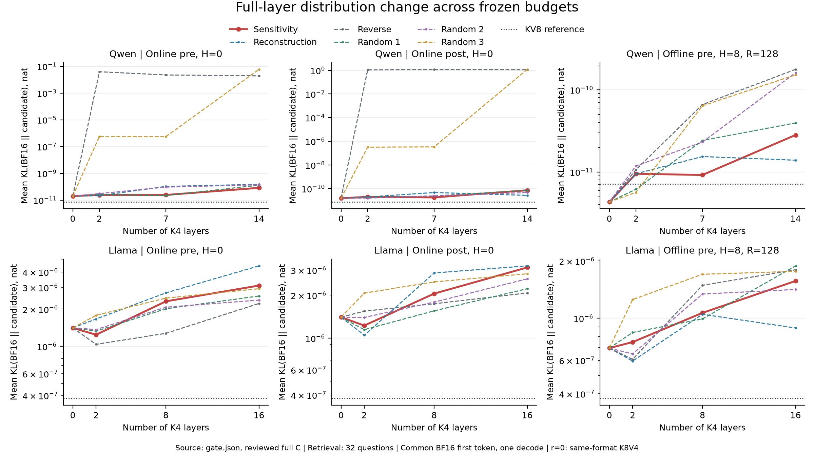

# Key 降位宽敏感度与静态层分配

本文回答：在 Value 主存固定 INT4 时，能否按各层 Key 从 INT8 降到 INT4 的局部影响选择部分层，减少完整缓存成本，并保持较小的模型输出偏差？更新日期为 2026-10-09。测量对象是 Qwen2.5-7B-Instruct 与 Llama-3.1-8B-Instruct 在三个底层格式下的逐层输出变化，以及三档冻结预算的全层下一步预测分布。

来源说明：设计与默认参数见 `research/phase1/guide.md`、`research/phase1/configs/static_layer_allocation.json`、`research/phase1/configs/data.md`、`research/phase1/configs/quant.md` 和 `research/phase1/configs/runtime.md`。执行及审核代码在 `research/phase1/experiments/static_layer_allocation/code/`：`probe.py` 测量层间代价，`allocations.py` 冻结分配并计数成本，`gate.py` 测量全层 KL，`numerical_check.py` 核查实际词表分布和近零数值，`review.py` 复算结果，`plot.py` 从审核后的结果作图。下文“层间测量”“冻结分配”“全层比较”“数值核验”分别对应 `research/phase1/experiments/static_layer_allocation/results/{qwen,llama}/` 中的 `probe.json`、`allocations.json`、`gate.json`、`numerical_check.json`；统一审核为该结果目录的 `review.json`。已有生成质量状态和在线 post KV4 的严重失效来自 `research/phase1/experiments/generation_error_sources/results/` 的 `residual_diagnostics.json` 及 Qwen 的 `v_gsm8k_kv4-per_token-post_early_stop.json`。详细执行来源、校验和历史结果的替换记录集中在 `research/phase1/source_index.json`。

本轮两模型均重新捕获当前完整键匹配题面上的高精度轨迹，离线 K4、K8 分别读取全部 C 冻结的对应位宽参数。权重与激活为 BF16，局部注意力及全层 decode 注意力按共同 FP32 路径计算，相对误差累加和词表 KL 使用 FP64。同题的全层配置共用一次 BF16 prefill，各自独立构建量化缓存；两模型在 64、192 token 的混合位宽、残留及 KV8 核验中，有效缓存与原独立 prefill 入口的 logits 均逐值一致。

## 实验目的

第一项实验在共同高精度轨迹上固定 query、层输入和同一份 V4，测量每层由 K8V4 改为 K4V4 的注意力输出变化，形成各格式自己的检索排名；数学排名用于检查跨任务一致性。第二项实验把排名转成仅在 K 侧分配的完整位宽表，在全部层同时量化时比较敏感度、重建、反向及三个随机策略。主判据为同模型、同格式、同预算下的检索题均 KL：敏感度策略须严格低于全部三个随机策略，并分别记录其与重建、反向的比较。局部敏感度承担层排序证据，全层 KL 承担完整方案的预测分布证据，真实生成评分承担任务质量证据。

Qwen 为 28 层、Llama 为 32 层，每模型均使用冻结 C 的数学 64 题、检索 32 题，题目是独立统计单位。三个条件为在线 per-token pre-RoPE、在线 per-token post-RoPE（均 H=0），以及离线 per-channel pre-RoPE（H=8、R=128）；V 主存均为在线 per-token INT4，近期 K/V 副本按同一残留规则另外计数。Qwen 的数学输入为 98–184 token、检索为 2,038–4,096 token；Llama 对应为 102–183、2,034–4,095 token。query 位置是高精度 prefill 后首个生成 token 所在位置。所有格式均作为开发条件，已有质量状态按条件保留。

## 实验结果与结论

### 不同表示下 Key 降位宽的层间代价

对题目 $i$、层 $\ell$ 和 KV head 对应的 query head 组 $g$，共同参考输出记为 $o^{\mathrm{ref}}_{i,\ell,g}$，主要指标为

$$
S_\ell=
\operatorname{平均}_{i,g}
\frac{\left\|o^{K4V4}_{i,\ell,g}-o^{K8V4}_{i,\ell,g}\right\|_2^2}
{\left\|o^{\mathrm{ref}}_{i,\ell,g}\right\|_2^2}.
$$

先对同题的有效组计算相对误差并平均，再对子集题目等权平均。K8、K4 均从同一高精度源值直接量化，共用相同 V4、RoPE 与残留条件。分母取共同高精度输出。两模型三格式的全部测量中，无效量化组和零能量组均为 0。该指标测量降位宽造成的局部变化；同时保存 $E_{84}$、$E_{44}$，即 K8V4、K4V4 各自相对共同参考的同口径误差，以核对变化方向。

下图来自层间测量，每条数学曲线为 64 题、检索曲线为 32 题的题均相对平方变化，无量纲。纵轴采用对称对数尺度，$10^{-6}$ 附近为线性区，各子图范围不同；标注的是检索敏感度最高的两层，层号从 0 开始。

下表概括同图的检索分布，$S$、$E_{84}$、$E_{44}$ 的层均值在每层题均结果上再对层等权平均；“前两层占比”是两层 $S$ 之和占全层 $S$ 之和的比例。

| 模型 | 格式 | 层均值 $S$ | 最大层 | 最大 $S$ | 前两层占比 | 层均值 $E_{84}$ | 层均值 $E_{44}$ |
| --- | --- | ---: | ---: | ---: | ---: | ---: | ---: |
| Qwen | 在线 pre | 0.071317 | 0 | 1.035507 | 66.18% | 0.004631 | 0.075074 |
| Qwen | 在线 post | 0.072317 | 0 | 1.074042 | 63.39% | 0.004630 | 0.076217 |
| Qwen | 离线 pre，H=8 | 0.013312 | 4 | 0.082954 | 29.60% | 0.001895 | 0.015354 |
| Llama | 在线 pre | 0.012430 | 1 | 0.042615 | 18.41% | 0.005220 | 0.017619 |
| Llama | 在线 post | 0.012249 | 1 | 0.046723 | 19.36% | 0.005204 | 0.017414 |
| Llama | 离线 pre，H=8 | 0.010246 | 25 | 0.018541 | 11.22% | 0.003115 | 0.013353 |

Qwen 两个在线格式都由第 0、27 层贡献主要变化：合计占 66.18%、63.39%，第 0 层的 $S$ 超过 1。中间层存在明显例外，第 1、3、13 层也高于多数层。离线 pre、H=8 的最大层转为第 4 层（0.082954），其次为第 25 层（0.027385），前两层占比降至 29.60%；第 0、1 层反而进入低敏感端。层间代价的位置和差距随整个底层条件改变，因此三个条件各自形成分配排名。

Llama 的在线高敏感端集中在第 1、2 层，但前两层只占约 18%–19%，其余层的贡献更分散；在线 pre 的第 3 层为 0.024981，在线 post 的第 4 层为 0.022753。离线 pre、H=8 的高敏感层转向第 25、23 层，二者为 0.018541、0.018243，前两层占比仅 11.22%。Qwen 的在线首末层集中现象没有成为 Llama 的共同层形状。

检索子集上各层的 $E_{44}$ 均高于 $E_{84}$，但“变化大小”与“离参考更远”仍是两个测量量。数学子集存在一个方向例外：Qwen 离线 pre 的第 0 层，$E_{84}=0.005289449$，$E_{44}=0.005281493$，降位宽后平均参考误差略小。离线条件还受窗口覆盖影响：Qwen 有 27/64、Llama 有 23/64 道数学题的全部可见历史落在 128-token 残留窗口内；这些题的局部 $S$ 全为 0，后续全层比较中同格式各 K 位宽表的 KL 也完全相同。检索题均长于残留窗口。

重建对照使用 K4 相对高精度 K 的逐 KV-head 相对平方张量误差。pre 条件沿用旋转后的主存张量口径，在近期副本替换之前计算。它按 K4 张量失真排序，测量对象与注意力输出变化不同。下表来自层间测量，两子集仍各为数学 64、检索 32 题；Spearman 使用固定层号规则处理并列，高敏感集合取排名前一半，即 Qwen 14 层、Llama 16 层。

| 模型 | 格式 | 数学—检索相关 | 高集合重合 | 检索 $S$—重建相关 | 高集合重合 |
| --- | --- | ---: | ---: | ---: | ---: |
| Qwen | 在线 pre | 0.698 | 10/14 | 0.238 | 7/14 |
| Qwen | 在线 post | 0.720 | 10/14 | 0.201 | 7/14 |
| Qwen | 离线 pre，H=8 | 0.828 | 11/14 | 0.476 | 9/14 |
| Llama | 在线 pre | 0.678 | 12/16 | 0.113 | 9/16 |
| Llama | 在线 post | 0.660 | 13/16 | 0.201 | 10/16 |
| Llama | 离线 pre，H=8 | 0.626 | 11/16 | 0.390 | 9/16 |

数学与检索的敏感度相关系数为 0.626–0.828，高敏感集合重合为 10/14–13/16。两子集有共同高敏感区，也有足以改变具体低敏感层名单的差异。检索敏感度与重建排名的相关性仅为 0.113–0.476，高集合重合为 7/14–10/16，说明张量失真排序与输出变化排序产生了实质不同的对照。

正式分配始终使用检索敏感度从低到高的顺序，下表给出三个预算使用的前缀，层号从 0 开始；完整逐层排序、数学排序和检索重建排序保存在层间测量中，并列按层号升序。

| 模型 | 格式 | 2 层 | 四分之一 K 层 | 一半 K 层 |
| --- | --- | --- | --- | --- |
| Qwen | 在线 pre | 24, 14 | 24, 14, 11, 23, 12, 21, 18 | 24, 14, 11, 23, 12, 21, 18, 20, 22, 5, 25, 26, 8, 10 |
| Qwen | 在线 post | 24, 5 | 24, 5, 14, 23, 21, 12, 22 | 24, 5, 14, 23, 21, 12, 22, 20, 25, 11, 18, 8, 26, 17 |
| Qwen | 离线 pre，H=8 | 1, 0 | 1, 0, 3, 2, 6, 10, 18 | 1, 0, 3, 2, 6, 10, 18, 11, 15, 13, 7, 20, 12, 5 |
| Llama | 在线 pre | 10, 30 | 10, 30, 11, 13, 20, 14, 19, 15 | 10, 30, 11, 13, 20, 14, 19, 15, 16, 21, 17, 7, 23, 18, 6, 12 |
| Llama | 在线 post | 30, 10 | 30, 10, 11, 13, 21, 19, 16, 20 | 30, 10, 11, 13, 21, 19, 16, 20, 14, 17, 15, 31, 18, 12, 27, 6 |
| Llama | 离线 pre，H=8 | 0, 12 | 0, 12, 1, 7, 31, 6, 4, 11 | 0, 12, 1, 7, 31, 6, 4, 11, 3, 8, 14, 5, 10, 21, 15, 16 |

### 不同预算下的 Key 位宽分配与全层验证

每套策略选 $r$ 层 K4，其余 $L-r$ 层 K8，全部 V 主存为 V4，总 K/V 单位的 INT8 比例为

$$
p_{\mathrm{INT8}}=\frac{L-r}{2L}.
$$

Qwen 的 $r=2,7,14$，Llama 的 $r=2,8,16$；少量降位宽点对应 INT8 比例 46.43%、46.875%，四分之一与一半 K 层降位宽分别对应 37.5%、25%。每预算的六策略为：最低敏感度、最低 K4 重建误差、最高敏感度，以及三个固定种子的随机排列前缀。每种子的随机集合在预算间嵌套，同模型三格式共用相同随机集合。位宽表在全层测量前冻结。唯一策略重合是 Qwen 离线 pre 的 2 层预算：敏感度与重建均选择第 0、1 层，复用同一测量；其余命名配置均不同。

下表来自冻结分配的完整布局计数，batch=1，长度 32K=32,768、4K=4,096 token，单位 MiB（$2^{20}$ 字节）。容量包含 K/V 载荷、量化参数、128 字节对齐和近期残留；同模型、格式、预算的六策略具有相同 INT8 数量和完整字节。“一半节省”相对同格式全层 K8V4。

| 模型 | 格式 | K8V4，32K | 2 层，32K | 四分之一，32K | 一半，32K | 一半，4K | 一半节省 |
| --- | --- | ---: | ---: | ---: | ---: | ---: | ---: |
| Qwen | 在线 pre | 784.000 | 768.000 | 728.000 | 672.000 | 84.000 | 14.29% |
| Qwen | 在线 post | 784.000 | 768.000 | 728.000 | 672.000 | 84.000 | 14.29% |
| Qwen | 离线 pre，H=8 | 731.992 | 715.992 | 675.992 | 619.992 | 80.992 | 15.30% |
| Llama | 在线 pre | 1792.000 | 1760.000 | 1664.000 | 1536.000 | 192.000 | 14.29% |
| Llama | 在线 post | 1792.000 | 1760.000 | 1664.000 | 1536.000 | 192.000 | 14.29% |
| Llama | 离线 pre，H=8 | 1673.125 | 1641.125 | 1545.125 | 1417.125 | 185.125 | 15.30% |

把一半 K 层降为 INT4，在线条件在 32K 减少 14.29% 完整容量，离线 pre、H=8 减少 15.30%。相同 INT8 比例的跨格式成本不同：Qwen 一半预算的在线容量为 672 MiB，离线为 619.992 MiB；Llama 为 1,536 与 1,417.125 MiB。离线格式的 Key 参数容量减少，同时增加近期副本。

同一冻结分配在一半预算、32K 下的组成与传输计数如下。读量下界跳过近期副本已覆盖的主存尾部，上界读取完整主存和副本；写量是新增主存与近期副本更新之和。pre 旋转项按完整主存读取计数，单位为十亿次乘加。prefill 转换写量及所有预算的读写组成保存在冻结分配中。

| 模型 | 格式 | 参数 MiB | 残留 MiB | 对齐补齐 B | 读量 MiB，下界—上界 | 写量 B | pre 旋转，十亿乘加 |
| --- | --- | ---: | ---: | ---: | ---: | ---: | ---: |
| Qwen | 在线 pre | 112.000 | 0.000 | 0 | 672.000–672.000 | 21504 | 1.409 |
| Qwen | 在线 post | 112.000 | 0.000 | 0 | 672.000–672.000 | 21504 | 0.000 |
| Qwen | 离线 pre，H=8 | 56.055 | 3.938 | 0 | 617.586–619.992 | 51968 | 1.409 |
| Llama | 在线 pre | 256.000 | 0.000 | 0 | 1536.000–1536.000 | 49152 | 3.221 |
| Llama | 在线 post | 256.000 | 0.000 | 0 | 1536.000–1536.000 | 49152 | 0.000 |
| Llama | 离线 pre，H=8 | 128.125 | 9.000 | 0 | 1411.625–1417.125 | 118784 | 3.221 |

离线 pre 的较小容量伴随更高的每步写量：Qwen 为 51,968 字节、Llama 为 118,784 字节，而两个在线格式分别为 21,504、49,152 字节。在线 pre 与 post 的字节相同，pre 还承担 Key 旋转。容量、读量、写量和旋转共同构成这里的成本比较。

全层比较同时应用目标位宽表，以共同 BF16 首 token 为输入，对其后一步 decode 的词表分布计算

$$
G(a)=\operatorname{平均}_i
D_{\mathrm{KL}}\!\left(p_i^{\mathrm{BF16}}\middle\|p_i^a\right).
$$

各题 KL 先独立计算，再按数学或检索子集等权平均，单位 nat；主比较使用检索 32 题。全部对照统一使用 FP64 归一化恒等式计算，BF16 自身为 0。在线 post 的既定 KV8 在 Qwen 检索、数学分别为 $7.168276\times10^{-12}$、$5.121608\times10^{-4}$，Llama 为 $3.776297\times10^{-7}$、$7.555538\times10^{-4}$。下面同格式起点与端点表来自全层比较，数学每格 64 题、检索每格 32 题。

| 模型 | 格式 | 检索 K8V4 | 检索 KV4 | 数学 K8V4 | 数学 KV4 |
| --- | --- | ---: | ---: | ---: | ---: |
| Qwen | 在线 pre | 2.000820e-11 | 1.013022e-01 | 8.073415e-04 | 6.003481e+00 |
| Qwen | 在线 post | 1.499366e-11 | 7.051088e-01 | 1.348508e-03 | 5.797838e+00 |
| Qwen | 离线 pre，H=8 | 4.315857e-12 | 3.953911e-10 | 5.112548e-04 | 9.002114e-04 |
| Llama | 在线 pre | 1.410253e-06 | 4.888211e-06 | 1.444735e-03 | 5.742039e-03 |
| Llama | 在线 post | 1.402368e-06 | 4.501704e-06 | 1.406417e-03 | 4.596488e-03 |
| Llama | 离线 pre，H=8 | 6.959376e-07 | 2.866133e-06 | 6.444496e-04 | 9.257791e-04 |

Qwen 的两个在线全层 KV4 端点在数学上达到 6.003481、5.797838 nat，明显高于相应 K8V4 起点；离线 pre、H=8 的端点为 0.000900211 nat。历史在线 post KV4 的 GSM8K 真实生成在前 9 题中 0 题正确并按严重失效规则停止，这一负结果保留。此次分别测量了三格式的单步端点，它们具有不同的预测分布偏差。

同格式 K8V4 的已有 GSM8K、HotpotQA 质量区间状态均为“证据不足”。初始 64 题的类单元点估计，Qwen 在线 pre 的两个单元在既定 2 分容差内；在线 post 的问答、离线 pre 的两个单元未满足该点估计条件。Llama 三个条件的两个单元点估计均满足条件。这些状态随各条件保存在冻结分配和全层比较中。

下图及随后的两表为全层比较的主对照：每点为检索 32 题的题均 KL，参照共同 BF16，纵轴为对数尺度，各子图范围不同。$r=0$ 为同格式 K8V4，虚线参照为既定 KV8。表中随机 1–3 按冻结种子登记顺序排列，最后一列依次回答敏感度是否严格低于全部三个随机、是否低于重建、是否低于反向。科学记数保留近零方案之间的差异。

Qwen：

| 格式 | $r$ | 敏感度 | 重建 | 反向 | 随机 1 | 随机 2 | 随机 3 | 三随机／重建／反向 |
| --- | ---: | ---: | ---: | ---: | ---: | ---: | ---: | --- |
| 在线 pre | 2 | 2.416345e-11 | 2.162116e-11 | 3.899784e-02 | 2.602976e-11 | 3.076007e-11 | 5.707483e-07 | 是/否/是 |
| 在线 pre | 7 | 2.434941e-11 | 1.055443e-10 | 2.239331e-02 | 2.194560e-11 | 9.399028e-11 | 5.517299e-07 | 否/是/是 |
| 在线 pre | 14 | 8.239837e-11 | 1.507275e-10 | 1.918129e-02 | 1.295909e-10 | 1.398025e-10 | 5.861698e-02 | 是/是/是 |
| 在线 post | 2 | 1.975017e-11 | 1.928920e-11 | 1.088427e+00 | 1.775376e-11 | 1.550260e-11 | 3.141679e-07 | 否/否/是 |
| 在线 post | 7 | 1.765660e-11 | 4.580847e-11 | 1.180552e+00 | 2.340699e-11 | 2.366388e-11 | 3.326280e-07 | 是/是/是 |
| 在线 post | 14 | 7.131479e-11 | 2.630906e-11 | 1.119234e+00 | 7.119377e-11 | 4.569081e-11 | 1.201055e+00 | 否/否/是 |
| 离线 pre，H=8 | 2 | 9.525244e-12 | 9.525244e-12 | 1.066881e-11 | 6.185685e-12 | 1.187555e-11 | 5.671899e-12 | 否/否/是 |
| 离线 pre，H=8 | 7 | 9.206863e-12 | 1.541373e-11 | 6.604358e-11 | 2.417068e-11 | 2.309430e-11 | 6.385909e-11 | 是/是/是 |
| 离线 pre，H=8 | 14 | 2.817273e-11 | 1.391692e-11 | 1.769167e-10 | 3.955649e-11 | 1.606953e-10 | 1.517432e-10 | 是/否/是 |

Llama：

| 格式 | $r$ | 敏感度 | 重建 | 反向 | 随机 1 | 随机 2 | 随机 3 | 三随机／重建／反向 |
| --- | ---: | ---: | ---: | ---: | ---: | ---: | ---: | --- |
| 在线 pre | 2 | 1.241058e-06 | 1.663843e-06 | 1.037244e-06 | 1.327454e-06 | 1.367545e-06 | 1.782404e-06 | 是/是/否 |
| 在线 pre | 8 | 2.312767e-06 | 2.708240e-06 | 1.273935e-06 | 2.014050e-06 | 2.072382e-06 | 2.457502e-06 | 否/是/否 |
| 在线 pre | 16 | 3.103413e-06 | 4.480052e-06 | 2.222147e-06 | 2.556088e-06 | 2.367629e-06 | 2.928848e-06 | 否/是/否 |
| 在线 post | 2 | 1.226003e-06 | 1.049400e-06 | 1.546464e-06 | 1.147126e-06 | 1.397346e-06 | 2.069731e-06 | 否/否/是 |
| 在线 post | 8 | 2.052764e-06 | 2.863961e-06 | 1.742573e-06 | 1.554760e-06 | 1.789675e-06 | 2.479241e-06 | 否/是/否 |
| 在线 post | 16 | 3.129594e-06 | 3.210442e-06 | 2.074523e-06 | 2.221162e-06 | 2.604963e-06 | 2.826663e-06 | 否/是/否 |
| 离线 pre，H=8 | 2 | 7.487403e-07 | 5.951927e-07 | 6.073554e-07 | 8.409817e-07 | 6.482002e-07 | 1.253068e-06 | 否/否/否 |
| 离线 pre，H=8 | 8 | 1.066261e-06 | 1.048252e-06 | 1.489214e-06 | 9.909129e-07 | 1.339886e-06 | 1.702341e-06 | 否/否/是 |
| 离线 pre，H=8 | 16 | 1.569751e-06 | 8.877379e-07 | 1.797862e-06 | 1.884432e-06 | 1.415665e-06 | 1.763202e-06 | 否/否/是 |

Qwen 有 5/9 个工作点低于全部三个随机：在线 pre 的 2、14 层，在线 post 的 7 层，离线 pre 的 7、14 层。在线 pre 的 7 层却略高于随机 1，在线 post 的 2、14 层也没有满足门槛。重建比较并不一致：离线 pre 的 14 层虽然优于全部随机，却高于重建。三个比较同时成立的是在线 pre 的 14 层、在线 post 的 7 层和离线 pre 的 7 层。

Llama 仅在线 pre 的 2 层预算低于全部随机；该点还低于重建，却高于反向。所有 8、16 层预算均未满足三随机门槛。在线 pre 的反向策略在三个预算均低于敏感度，离线 pre 的重建策略也在三个预算均低于敏感度。局部排名对完整方案的优势因此表现出跨模型与跨格式的例外。一半 K 层预算没有成为两模型共同的优选工作点。

合计 18 个工作点中，敏感度有 6 个低于全部三个随机、9 个低于重建、12 个低于反向。这些判断对应各自模型、格式、预算和冻结 C 的方案级均值。六个三随机门槛通过点构成本轮待验证集合；三个全部对照同时成立的 Qwen 点提供较完整的方案对照证据。未通过点、重建和反向优势点以及三个随机策略同时保留。

数值核验进一步定位了近零 KL 的预测位置。全部 32 道检索题的共同首 token 均为 `val`，BF16 下一 token 均预测 `-`，对应冻结目标值的 `val-` 前缀。Qwen 对 `-` 的参考概率为 0.9999999929–0.9999999999990，熵为 $3.24\times10^{-11}$–$1.65\times10^{-7}$ nat；Llama 为 0.9997458–0.9999816，熵为 0.000272860–0.003279209 nat。低 KL 出现在这一共同前缀位置。固定首题、末题及全矩阵最大 KL 检索题，复算全部独立配置，两模型各 3 题均逐值复现原测量。扩展精度直接计算与稳定 FP64 的最大绝对差为 Qwen $3.55\times10^{-15}$、Llama $7.70\times10^{-19}$ nat；Qwen 小于 $10^{-8}$ nat 的核验值最大差为 $4.98\times10^{-19}$。全部正式 KL 为有限非负值。

预算增加也没有形成普遍单调关系。下表来自全层比较，前半为敏感度策略的数学题均 KL（64 题），后半为其检索 KL 减同格式 K8V4（32 题），单位均为 nat；完整结果同时保存六种策略每套方案的相对起点差值、逐题差值与预算间变化。

| 模型 | 格式 | 数学，2 层 | 数学，四分之一 | 数学，一半 | 检索差，2 层 | 检索差，四分之一 | 检索差，一半 |
| --- | --- | ---: | ---: | ---: | ---: | ---: | ---: |
| Qwen | 在线 pre | 9.145643e-04 | 1.703344e-03 | 2.800935e-03 | +4.1553e-12 | +4.3412e-12 | +6.2390e-11 |
| Qwen | 在线 post | 1.369161e-03 | 1.741275e-03 | 3.900678e-03 | +4.7565e-12 | +2.6629e-12 | +5.6321e-11 |
| Qwen | 离线 pre，H=8 | 5.436780e-04 | 4.111116e-04 | 5.778356e-04 | +5.2094e-12 | +4.8910e-12 | +2.3857e-11 |
| Llama | 在线 pre | 1.422137e-03 | 2.348637e-03 | 5.391088e-03 | -1.6920e-07 | +9.0251e-07 | +1.6932e-06 |
| Llama | 在线 post | 1.429105e-03 | 2.593579e-03 | 3.598974e-03 | -1.7636e-07 | +6.5040e-07 | +1.7272e-06 |
| Llama | 离线 pre，H=8 | 8.567150e-04 | 8.132791e-04 | 5.579087e-04 | +5.2803e-08 | +3.7032e-07 | +8.7381e-07 |

Qwen 在线 pre 的敏感度策略在两个子集随预算增大而升高；在线 post 的检索 KL 从 2 层到 7 层略降，再在 14 层升高。离线 pre 的 7 层点在数学、检索均低于 2 层点，数学还低于同格式 K8V4。Llama 两个在线 2 层点的检索 KL 也略低于起点，而四分之一、一半预算升高；离线 pre 的数学 KL 随 K4 层数增加而下降，检索却升高。这些差值描述完整方案的变化，与单层 $S$ 的可加分解不同。

逐题配对还区分了均值优势与大多数题优势。下表每行对照该预算均值最低的随机策略，仍为同一检索 32 题；“低／高／同”是敏感度 KL 相对该随机的题数，“前三题占比”为绝对差值最大的三题占全部绝对差值之和的比例。重建、反向及其余随机的完整配对记录在全层比较中。

| 模型 | 格式 | $r$ | 随机序号 | 低／高／同 | 前三题占比 |
| --- | --- | ---: | ---: | --- | ---: |
| Qwen | 在线 pre | 2 | 1 | 16/16/0 | 88.79% |
| Qwen | 在线 pre | 7 | 1 | 21/11/0 | 86.33% |
| Qwen | 在线 pre | 14 | 1 | 18/14/0 | 97.94% |
| Qwen | 在线 post | 2 | 2 | 19/13/0 | 76.79% |
| Qwen | 在线 post | 7 | 1 | 22/10/0 | 90.76% |
| Qwen | 在线 post | 14 | 2 | 17/15/0 | 91.96% |
| Qwen | 离线 pre，H=8 | 2 | 3 | 20/12/0 | 83.67% |
| Qwen | 离线 pre，H=8 | 7 | 2 | 20/12/0 | 88.76% |
| Qwen | 离线 pre，H=8 | 14 | 1 | 26/6/0 | 85.40% |
| Llama | 在线 pre | 2 | 1 | 11/21/0 | 45.10% |
| Llama | 在线 pre | 8 | 1 | 13/19/0 | 36.05% |
| Llama | 在线 pre | 16 | 2 | 17/15/0 | 51.19% |
| Llama | 在线 post | 2 | 1 | 16/16/0 | 37.77% |
| Llama | 在线 post | 8 | 1 | 13/19/0 | 41.51% |
| Llama | 在线 post | 16 | 1 | 10/22/0 | 55.95% |
| Llama | 离线 pre，H=8 | 2 | 2 | 14/18/0 | 38.96% |
| Llama | 离线 pre，H=8 | 8 | 1 | 17/15/0 | 53.70% |
| Llama | 离线 pre，H=8 | 16 | 2 | 10/22/0 | 37.65% |

Qwen 在线 pre 的 14 层点对随机 1 为 18 题低、14 题高，前三题占绝对差值的 97.94%；在线 pre 的 7 层点虽有 21/32 题较低，均值仍较高。该预算中，4,095 token 的精确键 `key-60be57af`（目标值 `val-60be57af`）一题的敏感度与随机 1 KL 分别为 $4.617065\times10^{-10}$、$1.356199\times10^{-10}$，这一正差贡献了均值逆转的重要部分。Llama 唯一通过点对随机 1 只有 11/32 题较低，前三题占比为 45.10%，也没有转成多数题一致优势。

大偏差同样集中。Qwen 在线 post 的 2 层反向策略选择第 0、27 层，检索均值为 1.088427 nat；敏感度与反向差值的前三题占比为 99.997%。其中 4,080 token、精确键 `key-60be57a6` 的题（目标值 `val-60be57a6`），反向 KL 为 18.919685 nat，敏感度为 $4.819476\times10^{-12}$。这个工作点形成明确的分布大偏差对照，均值结论与少数题的贡献一并保留。

本轮已确定三格式各自的排名、三预算位宽表、完整成本和全层比较，保留了三随机门槛通过集合及全部负比较。当前没有预先验证的通用 KL 质量合格线；开发真实生成筛选的样本、准入、评分、停止与预算保留规则尚未冻结，本轮未据 KL 选出质量合格预算。局部输出变化、当前一步词表偏差和真实生成质量分别保留其测量状态。

## 总结

K 降位宽代价的层间形状随模型与底层格式改变：Qwen 在线格式由首末层主导，Llama 更分散，离线 pre、H=8 的高敏感位置又不同。数学与检索排名有共同结构，重建与输出敏感度排序的相关性较弱。完整分配中敏感度仅在 6/18 个工作点低于全部三个随机；Llama 的全部较大预算没有通过，反向与重建在部分条件取得更低 KL。实测产出包括三格式独立排名、108 套预算策略位宽表及同格式端点、逐题分布比较和完整成本：一半 K 层降位宽在 32K 节省约 14.29%–15.30% 容量，但未形成共同优选或生成保质结论。

下一项真实生成验证承接本轮冻结位宽表、对应格式与残留规则，以及六个三随机门槛通过点和保留的重建、反向、随机对照，检验这些分布差异是否转化为任务质量差异。BF16、既定 KV8 和同格式 K8V4 继续承担质量参照；新数字键值检索已有 BF16 基线，需补齐同输入 KV8 与量化候选。进入 V 的格式、预算、策略数量和扩样规则另行冻结；当前共同 `val-` 前缀位置上的低 KL 留作分布证据。
